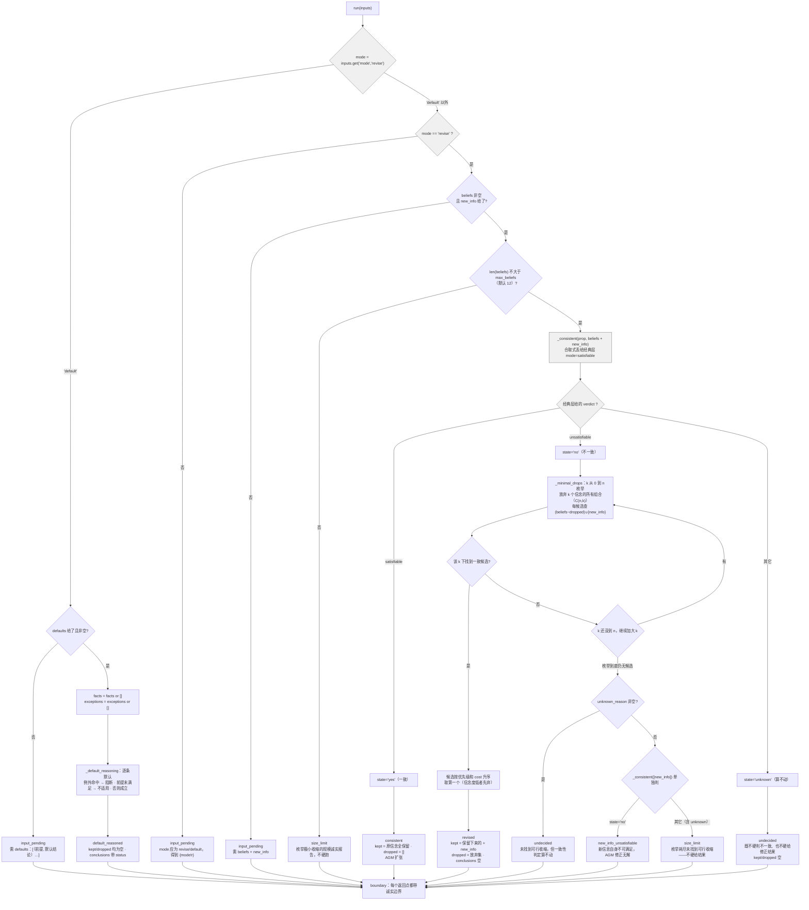

# AGM 信念修正 agm_revision — 逻辑流程图

> 模块：`engine/cold/agm_revision.py` · 层：第 3 层冷门逻辑（外部共识归借鉴区）
> 一句话：旧信念集 B 来了新信息 φ，判它们并在一起一不一致——一致就直接扩张，不一致就按
> **最小放弃**收缩出 B′ 并纳入 φ；另带一路**可废止**的默认推理（有例外即阻断）。
> 判据与写法约定见 `docs/diagrams/README.md`。

## 一、run(inputs) 主流程：两条 mode 分岔，先拦再判



## 二、三件套：一致性检查的三态 · 最小放弃的枚举 · 默认推理的阻断

```mermaid
flowchart TD
  subgraph "CONS[""_consistent：三态，绝不把算不动当矛盾"]
    A0["formulas 为空 → ('yes','空集视为一致')"] --> A1["合取式 '∧'.join('(f)')"]
    A1 --> A2["经典层 mode=satisfiable"]
    A2 --> A3{"verdict ?"}
    A3 -->|"satisfiable"| A4["'yes'"]
    A3 -->|"unsatisfiable"| A5["'no'"]
    A3 -->|"其它"| A6["'unknown' + 经典层 boundary 当理由"]
  end
  subgraph "DROP[""_minimal_drops：由小到大的最小放弃"]
    B0["k := 0 … n"] --> B1["itertools.combinations(range(n), k)"]
    B1 --> B2["dropped = 该组合 · kept = beliefs − dropped"]
    B2 --> B3["tested += 1（留痕：枚举了几个子集）"]
    B3 --> B4["_consistent(kept + [new_info])"]
    B4 -->|"'yes'"| B5["进 candidates"]
    B4 -->|"'unknown' 且首次"| B6["记下 unknown_reason"]
    B5 --> B7{"candidates 非空?"}
    B7 -->|是| B8["按 cost = Σ priorities.get(b,0) 排序<br/>返回第一个 → 最小放弃"]
    B7 -->|否| B9["k 加大；到底仍空 → 返回空 + unknown_reason"]
  end
  subgraph "DEF[""_default_reasoning：可废止，不是 Reiter 不动点"]
    C0["逐条 (pre, con)"] --> C1{"例外 exc 命中<br/>（子串匹配 fact_blob / exc_blob）<br/>且指向 pre 或 con ?"}
    C1 -->|是| C2["blocked<br/>理由：命中例外「exc」→ 默认被阻断"]
    C1 -->|否| C3{"pre 在 fact_blob 里（子串）?"}
    C3 -->|否| C4["not_applicable<br/>理由：前提「pre」未满足"]
    C3 -->|是| C5["holds<br/>理由：前提满足且无例外"]
  end
  A4 --> Q["返回 (state, reason)"]
  A5 --> Q
  A6 --> Q
  B8 --> D["drops_list[0] → dropped<br/>kept = beliefs − dropped"]
  C2 --> E["conclusions 追加<br/>{default, status, reason}"]
  C4 --> E
  C5 --> E
  classDef core fill:#e8f4fd,stroke:#4a90d9,stroke-width:2px
  classDef tool fill:#f0f0f0,stroke:#666
  classDef out fill:#e8f8e8,stroke:#2d8c2d,stroke-width:2px
  classDef stop fill:#fdecea,stroke:#c0392b
  class C0,C1,C2,C3,C4,C5 tool
```

## 三、对着代码核过的口径与边界

- **输入**（`PORTS['in']`）：`mode`（默认 `'revise'`，另一路 `'default'`）/ `beliefs` / `new_info` /
  `priorities` / `defaults` / `facts` / `exceptions` / `max_beliefs`。
- **判词**：`revised` · `consistent` · `default_reasoned` · `undecided` ·
  `new_info_unsatisfiable` · `input_pending` · `size_limit`。
  **本模块源码里没有 `parse_error`、也没有 `internal_error`**——命式不合法时是经典层返回
  `unsatisfiable`（判成不一致）或别的词，被本件归一成 `unknown` → `undecided`，
  不在这里另立解析错误词。结论侧的三个业务词原样照抄：`blocked` · `not_applicable` · `holds`。
- **关键常量**：`max_beliefs` 默认 **12**（是输入参数，不是模块级常量）；一致性复用的经典层
  真值表**原子数上限 10**——超了经典层算不动，本件照实报 `undecided`。放弃枚举规模是
  `Σ_{k≤n} C(n,k) = 2^n`。
- **留痕**：`revised` 的 boundary 里写了「枚举 {tested} 个子集」（`_minimal_drops` 的计数器，
  每个候选查一次 `_consistent` 加一）；`undecided` 的 boundary 里带上传来的算不动理由。
- **诚实边界**（`boundary` 字段随每个返回点带回）：一致性判定**复用经典命题逻辑**，
  自然语言要先自己结构化（不做通用 NLP 抽取）；一致性判定算不动时**绝不冒充"不一致"**
  去乱弃信念（算不动 ≠ 矛盾）；极小收缩只在 `max_beliefs` 上限内枚举，超了报 `size_limit`；
  「最优修正」依赖使用者给的 `priorities`（信念度），本件**不替使用者定优先级**；
  `mode='default'` 那一路是**工程简化（按例外阻断）**，**不是** Reiter 原义的 Γ 不动点——
  编辑说明里点明要完整不动点去用 cold.default_logic；只诊断不决策。
