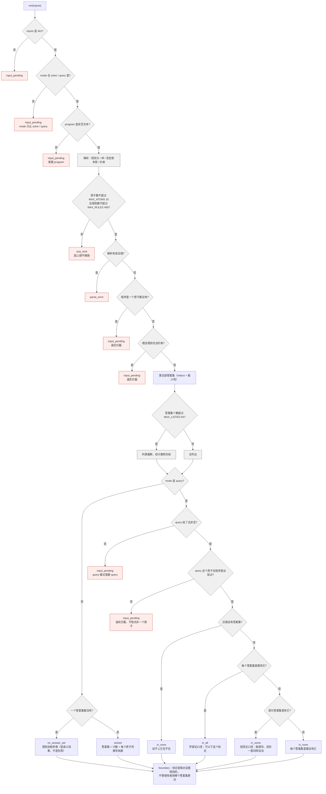
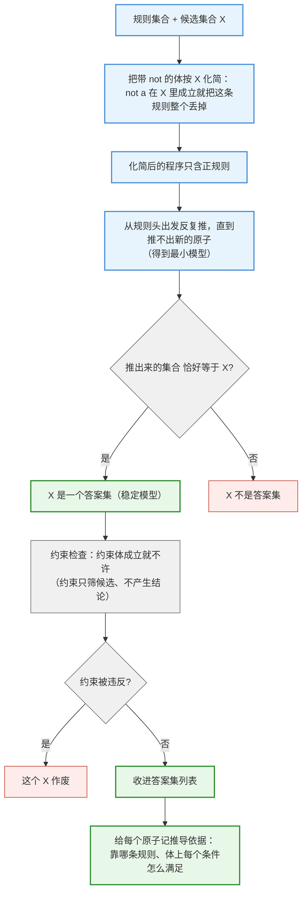

# 答案集程序 ASP — 逻辑流程图

> 模块：`engine/cold/asp.py` · 层：第 3 层（外部共识：Gelfond-Lifschitz 1988 稳定模型语义，归借鉴区）
> 一句话：算「规则 + 否定即失败 + 约束」这套写法下的**自洽结论集合**（答案集，可能一个、多个、
> 或**一个都没有**），并给每个原子的**推导依据**；还能按怀疑论 / 轻信论两种口径回答"某原子在不在"。
> 图 1 → `run()` 两种 mode 的主流程
> 图 2 → 答案集是怎么算出来的（reduct + 极小性）
> 判据与写法约定见 `docs/diagrams/README.md`。

## 一、run(inputs) 主流程

## 二、答案集怎么算：先化简（reduct），再验极小性

## 三、对着代码核过的口径与边界

- **输入**（`PORTS['in']`）：`mode`（`solve` / `query`）· `program`（规则文本）· `query`（要问的原子名）。
- **判词**：`solved` · `no_answer_set` · `in_all` · `in_some` · `in_none` · `input_pending` ·
  `parse_error` · `size_limit` · `internal_error`。
- **关键常量**：`MAX_ATOMS = 16` · `MAX_RULES = 400` · `MAX_LISTED = 64`（列表截断但**计数照实给**）。
- **两种口径写清**：`in_all` = 怀疑论（每个答案集里都有）；`in_some` = 轻信论（只在部分里有，
  且会报"几个里几个"）；`in_none` 分两种来路——**根本没有答案集**（谈不上在不在）与
  **每个答案集里都没有**。
- **推导依据**：每个原子记"靠哪条规则撑住"——结论不是"我说有就有"，是可逐条复核的。
- **诚实边界**：**只做正规则程序**——不做选择规则、基数约束、聚合、优化，也不做带变量规则的
  grounding（本构件是命题层面）；答案集**可能一个、多个或一个都没有**（没有就是规则自相矛盾），
  一律照实报；结论是**相对这套规则**的，**不替使用者挑"哪个答案集更对"**；只诊断不决策。
