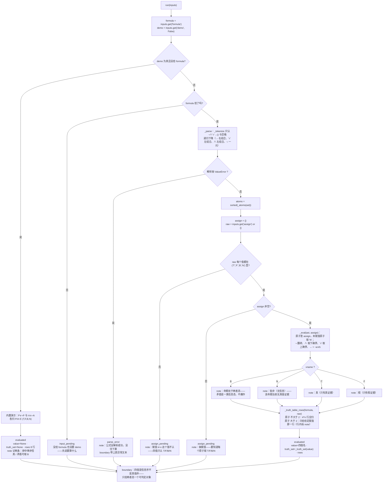

# Belnap 四值 belnap_four — 逻辑流程图

> 模块：`engine/cold/belnap_four.py` · 层：第 3 层冷门逻辑（外部共识归借鉴区）
> 一句话：把命题公式在**四值**（真 T / 假 F / 两者 B / 皆非 N）上求值——A 与 ¬A 都有证据时
> 取「两者」，**矛盾是一类信息态，不爆炸**；顺带给真值表与 {真,假} 子集视角。
> 判据与写法约定见 `docs/diagrams/README.md`。

## 一、run(inputs) 主流程：demo 一路、求值一路，各有各的拦截



## 二、核心算法：四值真值表 —— 联结词怎么定，矛盾为什么"不爆炸"

```mermaid
flowchart TD
  subgraph "SEM[""格语义（菱形：F小于T小于B 与 N小于T小于B，N∥B）"]
    S0["四值名 _FULL = ('T','F','B','N')"] --> S1["∧ = _MEET 下确界<br/>查表：T∧T=T · B∧B=B · T∧B=B · N∧N=N"]
    S1 --> S2["∨ = _JOIN 上确界<br/>查表：B∨N=T · B∨B=B · N∨N=N"]
    S2 --> S3["¬ = 垂直翻转<br/>T↔F · N→N · B→B"]
    S3 --> S4["→ = ¬a ∨ b（经典定义延拓）"]
    S4 --> S5["_truth_set：T→['真'] · F→['假'] · B→['真','假'] · N→[]"]
  end
  subgraph "FAT[""矛盾式的两条落点（同一张表，两种读法）"]
    F0["A∧¬A"] --> F1{"A 取什么?"}
    F1 -->|"T"| F2["T∧F = F → 不矛盾"]
    F1 -->|"F"| F3["F∧T = F → 不矛盾"]
    F1 -->|"B"| F4["B∧B = **B** → 两者态，**不爆炸**（不推出一切）"]
    F1 -->|"N"| F5["N∧N = N → 无信息"]
  end
  subgraph "EXE[""求值与表的驱动"]
    E0["_eval 递归：atom/¬/∧/∨/→ 五种节点"] --> E1["未赋值原子 → 'N'（无信息，诚实）"]
    E1 --> E2{"原子数 不大于 2?"}
    E2 -->|是| E3["itertools.product(_FULL, repeat=原子数)<br/>逐行 _eval 成表"]
    E2 -->|否| E4["只算给定赋值那一行 + note 说明"]
  end
  S4 --> E0
  E4 --> OUT["rows：[{原子: 四值, '→': 结果}]"]
  F4 --> OUT
  classDef core fill:#e8f4fd,stroke:#4a90d9,stroke-width:2px
  classDef tool fill:#f0f0f0,stroke:#666
  classDef out fill:#e8f8e8,stroke:#2d8c2d,stroke-width:2px
  classDef stop fill:#fdecea,stroke:#c0392b
  class OUT out
```

## 三、对着代码核过的口径与边界

- **输入**（`PORTS['in']`）：`formula` / `assign` / `demo`。
- **判词**：`evaluated` · `input_pending` · `parse_error` · `assign_pending`。
  **本模块没有 `size_limit`、也没有 `internal_error`**（不设规模上限，也不兜异常）——
  写坏赋值/坏公式一律走上面两个自己的拦截词。
- **关键常量**：`_FULL = ['T','F','B','N']`（合法四值名，就是 `assign` 白名单）；
  真值表**原子 ≤ 2 就全扫**（4^2=16 行），**> 2 只给给定赋值那一行**——
  这个阈值 2 写死在 `_truth_table_rows` 里，不是可调上限。
- **留痕字段**：`rows`（每行原子赋值 + 结果列，结果列的键就是 `'→'` 这个字符）；
  原子超过 2 时行内多一个 `note` 标「原子>2 仅显示给定赋值行」；`truth_set` 给 {真,假} 子集视角；
  `note` 按最终值四分支给一句人话。
- **诚实边界**（`boundary` 字段随每个返回点带回）：四值语义是**信息序不是真值序**，
  本件**不宣称解决说谎者真值问题**（哥德尔不违反），只是给「两者」态一个可判定的语义对象；
  只做**真值表/求值**（判定语义），**不做证明论**——次协调演算 LP / m4 不在本件范围；
  未赋值的原子取 `'N'`（无信息）是约定，不是"算出来为假"；只诊断不决策。
