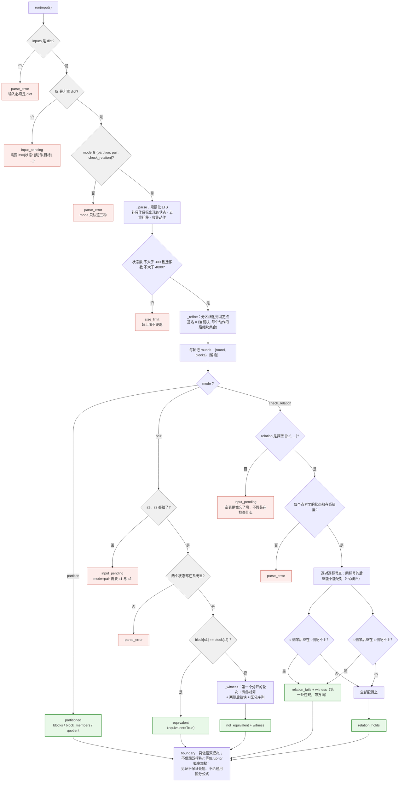

# 双模拟检查 bisimulation — 逻辑流程图

> 模块：`engine/cold/bisimulation.py` · 层：第 3 层（按痛点接入，外部共识归借鉴区）
> 一句话：给一个有限显式迁移系统，算**最大双模拟分划**（同块＝行为上分不开），判两态等不等价并给
> **可核的见证**，给定关系判它**是不是**双模拟，并给**商系统**。
> 判据与写法约定见 `docs/diagrams/README.md`。

## 一、run(inputs) 主流程：三种 mode 共用同一条"先分划"



## 二、分区细化与"见证"是怎么来的

```mermaid
flowchart TD
  subgraph "REF[""分区细化（到固定点）"]
    A0["初始：全体一块 block[s]=0"] --> A1["每个状态算签名：<br/>⟨当前块, frozenset(动作, 后继块)⟩"]
    A1 --> A2["按签名重新分块（保留确定顺序）"]
    A2 --> A3{"块数还增加吗?"}
    A3 -->|是| A1
    A3 -->|否| A4["固定点：同块 ＝ 强双模拟<br/>（非确定性天然按集合语义处理）"]
  end
  subgraph "WIT[""见证（不等价时）"]
    B0["找第一个把 s、t 分开的轮次 k"] --> B1["找出那个动作标号 lab：<br/>两侧后继块集合不同"]
    B1 --> B2["沿后继对往下走：<br/>**轮次严格递减** ⇒ 一定停"]
    B2 --> B3{"某一侧没有该动作的出边?"}
    B3 -->|是| B4["序列停在这个标号<br/>movable / dead_end_state"]
    B3 -->|否| B5["end_states = 两侧各一个终点<br/>（**它们一定不双模拟**）"]
  end
  A4 --> B0
  B5 --> Q["witness：{round, label, s/t_successor_blocks, sequence}"]
  classDef core fill:#e8f4fd,stroke:#4a90d9,stroke-width:2px
  classDef tool fill:#f0f0f0,stroke:#666
  classDef out fill:#e8f8e8,stroke:#2d8c2d,stroke-width:2px
  classDef stop fill:#fdecea,stroke:#c0392b
```

## 三、对着代码核过的口径与边界

- **输入**（`PORTS['in']`）：`lts` / `mode` / `s1` / `s2` / `relation`。
- **判词**：`partitioned` · `equivalent` · `not_equivalent` · `relation_holds` ·
  `relation_fails` · `input_pending` · `parse_error` · `size_limit` · `internal_error`。
- **关键常量**：`MAX_STATES=300` · `MAX_TRANS=4000` · `MAX_ROUNDS=400`。
- **留痕**：`rounds` 每轮的块数（"只跑一轮就停"这种错一眼能看出来）。
- **诚实边界**：只做**强双模拟**（同标号逐步匹配、非确定性用集合语义）；不做弱双模拟/τ 等价、
  不做 up-to、不做概率加权；不等价的见证是**可逐步核对的样例**，**不保证最短**、
  **不给通用区分公式**；与 `mu_calculus` 的分工是"它算公式在哪些状态成立、本件判两个状态
  是不是同一个行为"，两者可互验但不是一件事；只诊断不决策。
