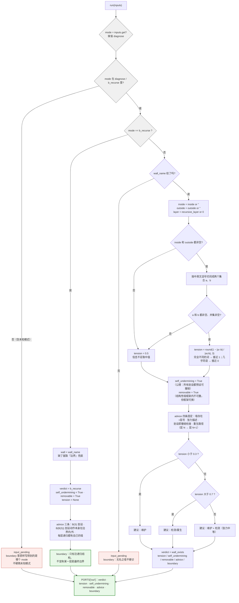

# 边界悖论判定 boundary_paradox — 逻辑流程图

> 模块：`engine/mechanisms/boundary_paradox.py` · 层：第 2 层机制（悖论创生 2.4，看墙件）
> 一句话：把"可计算/可判定/领域"的墙当**边界对象**诊断——墙在不在、张力多大、划设有没有预设可撤销、
> 该维护还是该换框架——**只诊断，不宣称墙不存在**。
> 判据与写法约定见 `docs/diagrams/README.md`。

## 一、run(inputs) 主流程：先分模式，再拦缺参，最后才诊断



## 二、张力度量怎么算的（白箱一遍）

```mermaid
flowchart TD
  subgraph "NORM[""① 规范化"]
    N0["原样拿 inside / outside"] --> N1["replace 中文逗号 → 空格<br/>replace 英文逗号 → 空格"]
    N1 --> N2["split 成词表 → set a、set b"]
  end
  subgraph "DEG[""② 退化成 0.5 的三种情形"]
    N2 --> G1{"任一侧为空串?"}
    G1 -->|"是"| G2["0.5"]
    G1 -->|"否"| G3{"任一侧的集合为空?"}
    G3 -->|"是"| G2
    G3 -->|"否"| G4{"并集为空?"}
    G4 -->|"是"| G2
    G4 -->|"否"| CALC["1 − a∩b 的个数 ÷ a∪b 的个数"]
  end
  subgraph "ONE[""③ 张力对建议的作用（只影响追加的那一条）"]
    CALC --> P1{"小于 0.3 ?"}
    P1 -->|"是"| P2["维护"]
    P1 -->|"否"| P2b{"大于 0.7 ?"}
    P2b -->|"是"| P3["检测/重生（检查是否该换框架）"]
    P2b -->|"否"| P4["维护 + 检测（保持观察）"]
  end
  CALC --> NOTE["另一处软分支：tension 大于 0.6 时<br/>张力那行 advice 追加『跨越压力高』<br/>（0.6 与 0.3、0.7 是两个不同的阈值，别混）"]
  classDef core fill:#e8f4fd,stroke:#4a90d9,stroke-width:2px
  classDef tool fill:#f0f0f0,stroke:#666
  classDef out fill:#e8f8e8,stroke:#2d8c2d,stroke-width:2px
  classDef stop fill:#fdecea,stroke:#c0392b
```

## 三、对着代码核过的口径与边界

- **输入**（`PORTS['in']`）：`wall_name` / `domain` / `inside` / `outside` / `recursive_layer` / `mode`。
  `domain` 与 `recursive_layer` 只在文案里用到（层号），**不参与任何判定**。
- **判词**（源码里真有的三个）：`wall_exists` · `b_recurse` · `input_pending`。
  本件**没有** `parse_error` / `size_limit` / `internal_error`——非 dict 的输入会直接 AttributeError，
  没有做结构校验（这是本件和其它构件不一致的地方，照实记下）。
- **两种 input_pending 分得开**：未知 mode 一条、缺 `wall_name` 一条，两者的 `boundary` 文案不同，
  靠文案区分，不靠额外的分歧字段。
- **关键常量 / 阈值**：`0.5`（内外任一为空时取中值）· `0.3`（低于它建议"维护"）·
  `0.7`（高于它建议"检测/重生"）· `0.6`（张力文案分界"跨越压力高"）· `round(..., 3)`。
- **留痕**：没有 events/trace 之类的时间线；留痕就是 `advice` 这几条（层号、张力值、重生路径写进文案），
  以及每个返回点都带的 `boundary`。
- **两个 True 是公理不是算出来的**：`self_undermining` 与 `removable` 在诊断分支里是**写死的常量**，
  不是根据输入推的——图上那条"公理"就是照这个写。
- **诚实边界**（`boundary` 随每个返回点带回）：advice 是**诊断建议不是执行动作**（只诊断不决策）；
  "可撤销"指**框架层可换**（升维/换公理），不是"图灵机可判定了"，**不宣称墙不存在**、
  不宣称绕停机或绕哥德尔；张力是**工程约定**（内外差异的度量），标了工程约定，**不冒充定理**。
