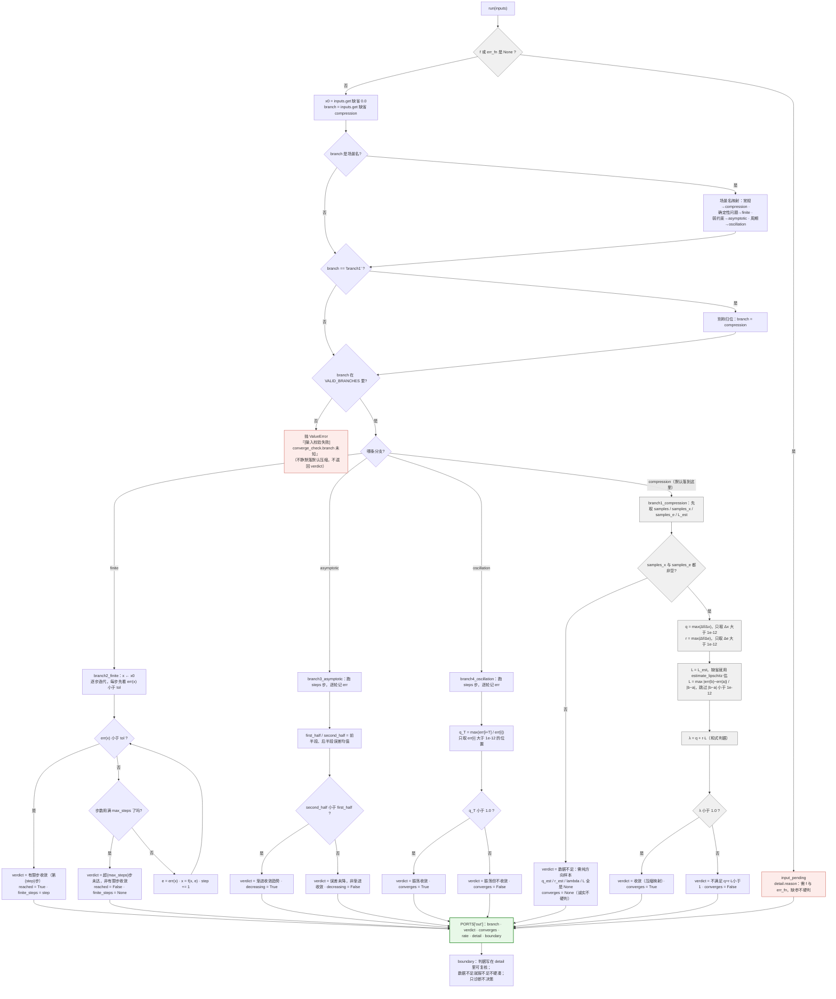

# 收敛判定四分支 converge_check — 逻辑流程图

> 模块：`engine/mechanisms/converge_check.py` · 层：第 2 层机制
> 一句话：判定递归修正序列 x_{n+1} = f(x_n, err(x_n)) 收不收敛——四条分支各按自己的判据
> （压缩映射 / 有限步 / 渐进 / 振荡），判据写进返回的 `detail` 里可复核，数据不足就报不足。
> 判据与写法约定见 `docs/diagrams/README.md`。

## 一、run(inputs) 主流程：先拦缺参、再认分支名、最后才进分支体



## 二、压缩映射分支的三条判据（公式卡 A1 + A2 + A3 怎么落到代码里）

```mermaid
flowchart TD
  subgraph "A2[""A2 拟压缩常数（分方向采样）"]
    X0["纯 x 方向样本 samples_x：<br/>每项 (Δx, Δf)，e 固定"] --> X1["q = 这些比值里的最大<br/>（Δx 不大于 1e-12 的项丢掉）"]
    E0["纯 e 方向样本 samples_e：<br/>每项 (Δe, Δf)，x 固定"] --> E1["r = 这些比值里的最大<br/>（Δe 不大于 1e-12 的项丢掉）"]
  end
  subgraph "A1[""A1 误差函数的 Lipschitz 常数"]
    L0["L_est 给了就照用"] --> L2
    L1["没给就 estimate_lipschitz(samples)：<br/>两两配对取 max，跳过同点"] --> L2["L"]
  end
  subgraph "A3[""A3 和式判据"]
    Q["q"] --> LAM["λ = q + r·L"]
    RR["r"] --> LAM
    L2 --> LAM
    LAM --> J{"λ 小于 1 ?"}
    J -->|"是"| C1["收敛（压缩映射）<br/>rate = λ · detail 给 q_est / r_est / L / n_x / n_e"]
    J -->|"否"| C2["不满足 q+r·L小于1"]
  end
  A2 --> MISS{"方向样本缺失或为空?"}
  MISS -->|"是"| C0["数据不足：需纯方向样本<br/>不硬判，converges = None"]
  A2 --> A3
  A1 --> A3
  LIM["实测限制（照实记）：<br/>没有上界检查，q/r 可能算出很大的值；<br/>samples 为空时 L 退化成 0.0，λ 只剩 q"] --> LAM
  classDef core fill:#e8f4fd,stroke:#4a90d9,stroke-width:2px
  classDef tool fill:#f0f0f0,stroke:#666
  classDef out fill:#e8f8e8,stroke:#2d8c2d,stroke-width:2px
  classDef stop fill:#fdecea,stroke:#c0392b
  class C0,C1,C2 tool
```

## 三、对着代码核过的口径与边界

- **输入**（`PORTS['in']`）：`branch` / `f` / `err_fn` / `x0`。另外还有只在 docstring 里点名、
  代码里用 `inputs.get` 取的分支专用项：`samples` / `samples_x` / `samples_e` / `L_est` /
  `max_steps` / `tol` / `steps` / `T`。
- **判词**（源码里真有的）：四条分支各自的文案——`input_pending` ·
  `数据不足：需纯方向样本` · `收敛（压缩映射）` · `不满足 q+r·L<1` ·
  `有限步收敛（第{step}步）` · `超{max_steps}步未达，非有限步收敛` ·
  `渐进收敛趋势` · `误差未降，非渐进收敛` · `振荡收敛` · `振荡但不收敛`。
- **非法 branch 不是 verdict**：拼错分支名走的是 `raise ValueError`（源码注释写得很清楚：
  以前拼错会静默落默认压缩映射、误导判定，所以改成硬报错）。图上照实画成抛错，不画成假判词。
- **本件没有的**：没有 `parse_error` / `size_limit` / `internal_error` 三个出口，
  f 与 err_fn 是不是 callable 也没查（传了非函数会在迭代里崩），照实记下。
- **关键常量**：`max_steps` 缺省 `1000` · `tol` 缺省 `1e-6` · 分支3 `steps` 缺省 `1000` ·
  分支4 `steps` 缺省 `200` · `T` 缺省 `2` · `x0` 缺省 `0.0` ·
  去重阈值 `1e-12`（两处：比值样本的 Δ 与 Lipschitz 的 |b−a|）· 判据线 `λ < 1.0` 与 `q_T < 1.0`。
- **rate 字段口径**：压缩分支给 `λ`，振荡分支给 `q_T`，有限步与渐进两支给 `None`——图上各自的出口写清了。
- **留痕**：没有逐轮 trace，留痕都在 `detail` 里——压缩分支给 `q_est / r_est / lambda / L / n_x / n_e`
  与 `converges`；有限步给 `finite_steps / reached`；渐进给 `err_tail / decreasing`；振荡给 `q_T / converges`。
- **诚实边界**（`boundary` 随每个返回点带回，压缩以外的分支用模块级 `BOUNDARY`）：四条分支各按自己的
  判据说"收敛 / 不收敛 / 数据不足"，**判据写在 detail 里可复核**；数据不足就报不足，**不拿缺样本硬凑结论**；
  **只诊断不决策**——不替使用者定这套递归该不该继续。另：压缩分支的 `q`、`r` 是**样本上的最大比值**
  （工程估计），不是证明出来的上确界；`err_fn` 与 `f` 的良态性由调用方负责。
