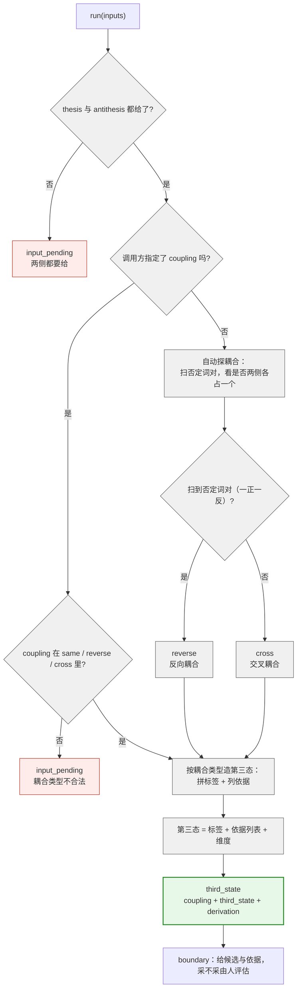
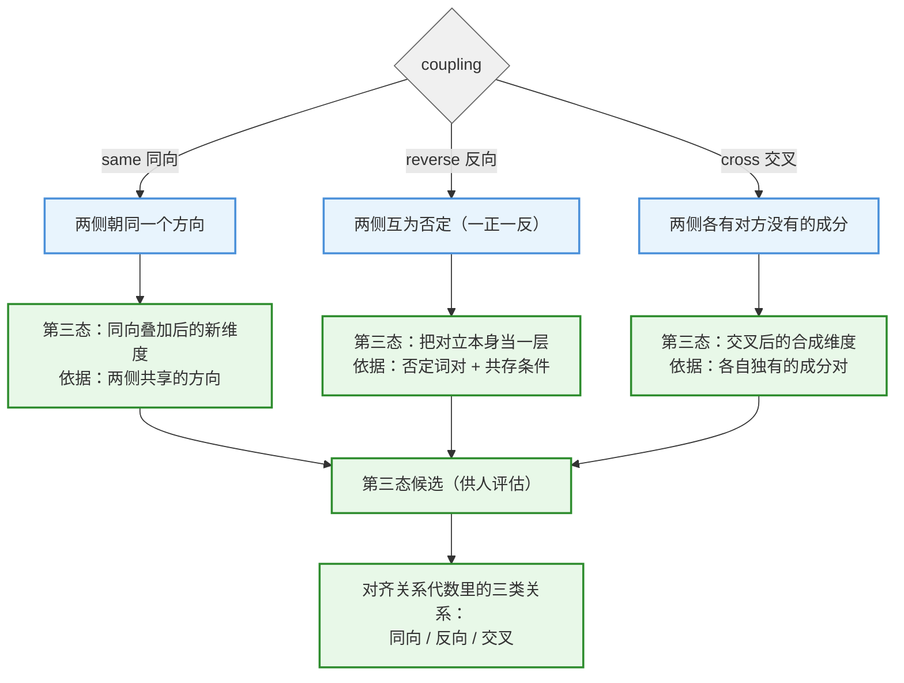

# 对位创生 counterpoint_gen — 逻辑流程图

> 模块：`engine/mechanisms/counterpoint_gen.py` · 层：第 2 层机制
> 一句话：把对立两侧交给"对位"——判它们怎么耦合（同向 / 反向 / 交叉），据此给出**第三态候选**
> 与**依据**（不是二选一，也不是和稀泥）。
> 图 1 → run() 主流程（校验 + 耦合判定 + 出第三态）
> 图 2 → 三种耦合各自怎么造第三态
> 判据与写法约定见 `docs/diagrams/README.md`。

## 一、run(inputs) 主流程

## 二、三种耦合各自怎么造第三态

## 三、对着代码核过的口径与边界

- **输入**（`PORTS['in']`）：`thesis` · `antithesis` · `coupling`（可省，省了就自动探）·
  `dimensions`（维度线索）。
- **判词**：`third_state` · `input_pending`（两条拦截：缺一侧 · 耦合类型不合法）。
- **耦合类型表**：`_VALID_COUPLING = {same, reverse, cross}`——**只认这三种**，不合法就拦。
- **自动探耦合**：扫内置的否定词对，若两侧各占一个 → `reverse`；否则 `cross`
  （**探不出来时不硬猜成同向**，落交叉）。
- **输出结构**：`third_state`（标签 + 依据 + 维度）· `derivation`（推导链，供人复核）·
  `coupling`（实际用的耦合类型，便于追溯）。
- **诚实边界**：出的是**候选 + 依据**，**不替使用者拍板**——"第三个态"要不要用，由人评估；
  与"二选一"和"折中"都不同：它要求给出**为什么这算第三态**。
