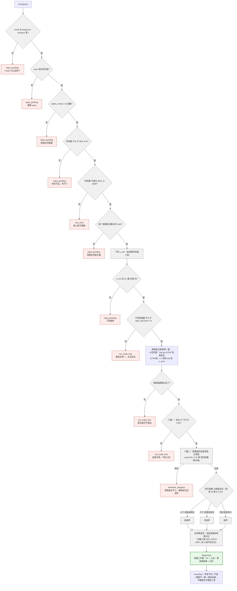
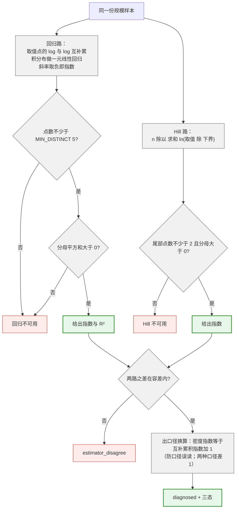

# 临界诊断 criticality — 逻辑流程图

> 模块：`engine/mechanisms/criticality.py` · 层：第 2 层机制（诊断层）
> 一句话：给一串「事件规模」，判它**是否落在无标度区间**，落在的话给幂律指数、**三态**
> （次临界/临界/超临界）、**距阈值多远**与**自举稳定性**。
> 图 1 → `run()` 主流程（四道校验 + 两道门槛 + 三态）
> 图 2 → 两条独立估计路与三个门槛（这是本件的核心：宁可不判，不硬判）
> 判据与写法约定见 `docs/diagrams/README.md`。

## 一、run(inputs) 主流程：先拦 → 两条路各算一遍 → 过两道门槛才给三态

## 二、两条独立估计路与三道闸（为什么"宁可不判"）

## 三、对着代码核过的口径与边界

- **输入**（`PORTS['in']`）：`mode`（`diagnose` / `compare`）· `sizes` · `sizes_b`（对照用）·
  `alpha_critical`（默认 2.0）· `tol`（默认 0.25）· `x_min` · `n_boot`（默认 200）· `seed`（默认 0，同输入同输出）。
- **判词**：`diagnosed` · `not_scale_free` · `estimator_disagree` · `input_pending` · `size_limit`
  （另：门槛前六道校验各自返回 `input_pending`，见上图）。
- **关键常量**：`MIN_N = 8` · `MIN_DISTINCT = 5` · `MAX_N = 5000` · `R2_GATE = 0.90` · `MAX_BOOT = 1000`。
- **两条路的差容差**：`max(0.25, 0.15 × |回归指数|)`——**两路对不上就不给三态**，这是本件最重要的一条纪律。
- **口径**：本件对外一律用**互补累积分布（CCDF）指数**；`alpha_pdf` 是**回归路**换算成密度指数的
  （＝ CCDF 指数 + 1）——**别拿它去和别人的 MLE 密度指数直接比**（两条路会差一个估计差）。
- **`compare` 模式**：只**并置事实**（两侧的三态与距离），不判"谁该停"；有一条没给出三态时如实说距离无从比。
- **诚实边界**（`boundary` 字段随每个返回点带回）：只做**形状与指数**的诊断；样本太少 / 直线不直 /
  两路不一致 → **直接报，不硬给三态**；阈值与容差是**参数**（默认值只是常用约定，不是体系结论）；
  **不做模型族检验**（幂律 vs 对数正态的正式比较要外部库）；只诊断不决策。
