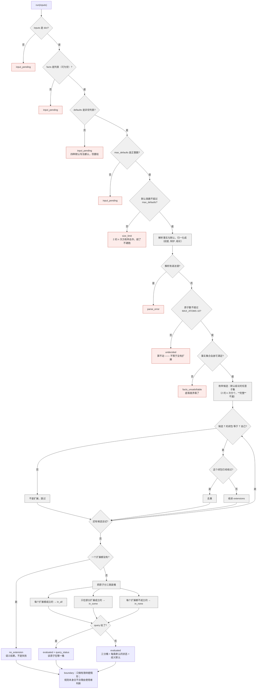
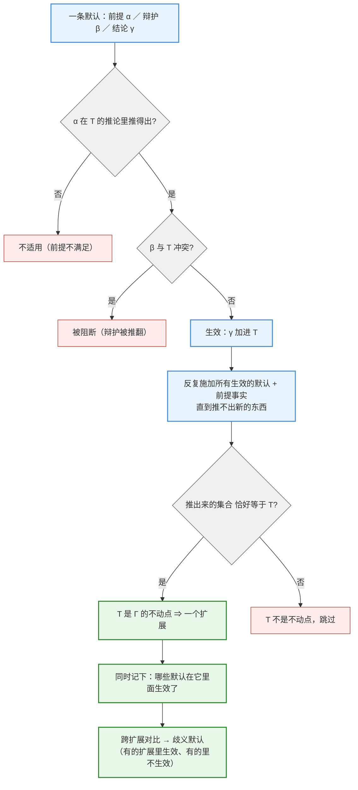

# 默认逻辑 default_logic — 逻辑流程图

> 模块：`engine/cold/default_logic.py` · 层：第 3 层（外部共识：Reiter 1980 原义，归借鉴区）
> 一句话：算出默认理论 (W, D) 的**全部扩展**（Γ 算子的不动点），分清
> "**每个扩展都成立**"与"**只在部分扩展成立**"——一个理论可能**没有**扩展，也可能有好几个。
> 图 1 → `run()` 主流程：解析 → 规模闸 → 枚举候选 → 逐个验不动点
> 图 2 → 一条默认什么时候生效 ＋ 不动点怎么验
> 判据与写法约定见 `docs/diagrams/README.md`。

## 一、run(inputs) 主流程

## 二、一条默认什么时候生效 ＋ "不动点才算扩展"

## 三、对着代码核过的口径与边界

- **输入**（`PORTS['in']`）：`facts`（命题式列表，可空）· `defaults`（默认规则，**四种写法都认**）·
  `query`（要问的原子）· `max_defaults`（默认条数上限）。
- **判词**：`evaluated` · `no_extension` · `facts_unsatisfiable` · `undecided` · `input_pending` ·
  `parse_error` · `size_limit`。
- **关键常量**：`MAX_ATOMS = 10` · `MAX_DEFAULTS = 12`（**2 的 n 次方枚举**的闸）。
- **输出分桶**：`extensions` · `in_all`（每个扩展都成立）· `in_some`（只在部分成立）·
  `in_none` · `default_status`（每条默认的状态）· `ambiguous_defaults`（**歧义默认**：
  有的扩展里生效、有的里不生效的那几条）· `query_status`。
- **两处"算不动"分得很清**：原子超上限 → `undecided`（**算不动 ≠ 没有扩展**）；
  默认条数超上限 → `size_limit`；而 `no_extension` 是**语义结果**（这个理论本来就没有扩展）。
- **诚实边界**：只做**有限命题**情形；扩展在默认条数的 2^n 个子集上**枚举候选再逐个验不动点**——
  **完整**（不漏扩展）；"有例外就阻断"是 `agm_revision` 的简化版，**不是本构件**；
  只诊断不决策——规则本身合不合理由使用者判断。
