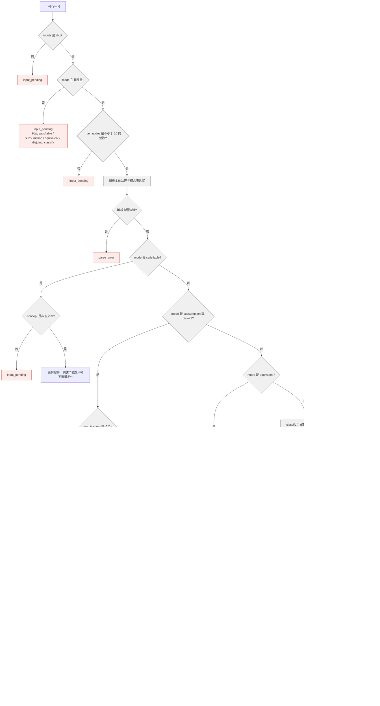
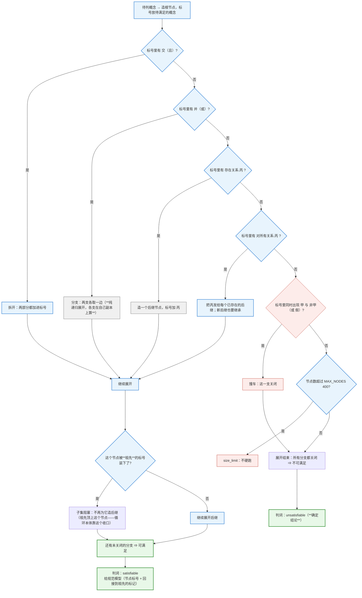

# 描述逻辑 ALC description_logic — 逻辑流程图

> 模块：`engine/cold/description_logic.py` · 层：第 3 层（外部共识：Baader & Sattler 2000 表列算法，归借鉴区）
> 一句话：判概念**可不可满足**、甲包不包含乙、两个概念**等不等价 / 相不相交**，以及整张本体的
> **概念层级**——表列法展开 + 子集阻塞，循环本体（甲定义成"存在关系指向甲自己"）也能收口。
> 图 1 → `run()` 五种 mode 的主流程
> 图 2 → 表列展开与"撞车 / 阻塞"（这是判定的地基）
> 判据与写法约定见 `docs/diagrams/README.md`。

## 一、run(inputs) 主流程：五种 mode，共用一台表列机

## 二、表列展开：展开到"处处撞车"就不可满足

## 三、对着代码核过的口径与边界

- **输入**（`PORTS['in']`）：`mode`（`satisfiable` / `subsumption` / `equivalent` / `disjoint` / `classify`）·
  `concept` · `sub` / `super` · `c1` / `c2` · `tbox` · `max_nodes`。
- **判词**：`satisfiable` · `unsatisfiable` · `subsumed` · `not_subsumed` · `equivalent` ·
  `not_equivalent` · `disjoint` · `not_disjoint` · `classified` · `input_pending` ·
  `parse_error` · `size_limit` · `internal_error`。
- **关键常量**：`MAX_NODES = 400` · `MAX_ATOMS_CLASSIFY = 8` · `MAX_LABEL_SHOWN = 40`。
- **两种结论的强度不同**（写进边界）：报**不可满足**是**确定结论**（表列全部分支关闭）；
  报**可满足**只给**规范模型**（可复核）。
- **子集阻塞的方向**：某节点的标号被**祖先**装下就不再为它造后继——方向反了就是"假阻塞"，
  这一条是历史真缺陷修出来的。
- **诚实边界**：**只做 ALC**——没有数量限制、没有角色层级 / 逆角色 / 传递角色、没有具体域；
  **只做概念层（TBox），不做 ABox 个体断言**；公理 `R ⊑ S` 在本语言里按**概念**包含读
  （名字长得像角色也当概念，本构件分不清）；节点超上限报 `size_limit` 不硬跑；只诊断不决策。
