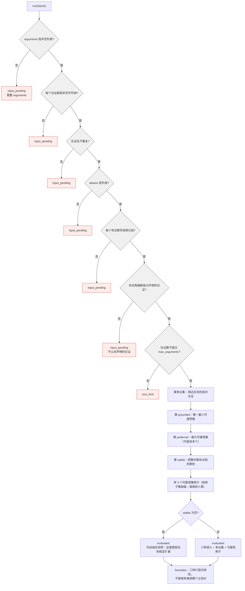
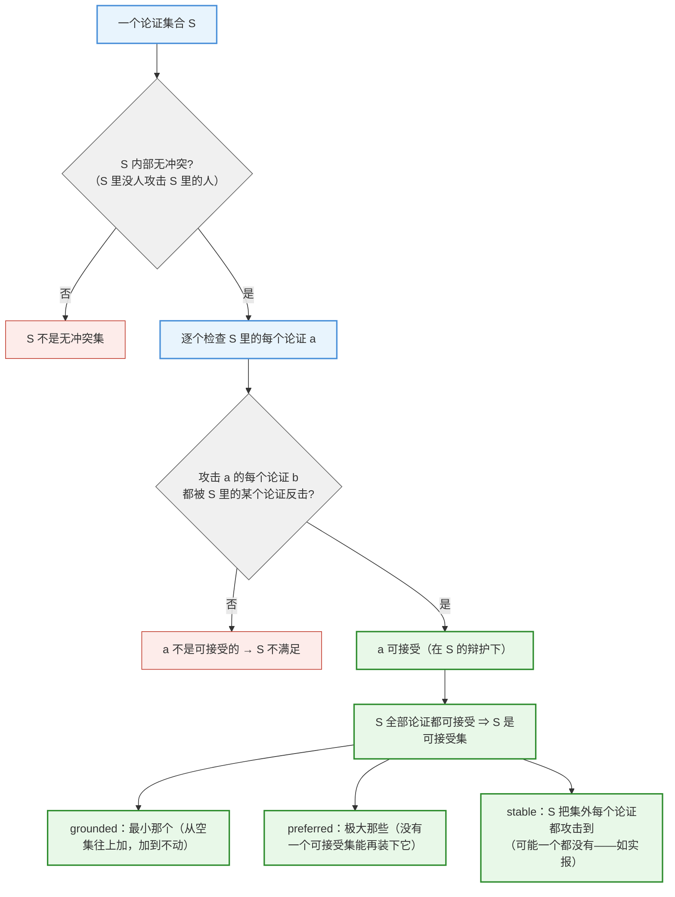

# Dung 论证框架 dung_framework — 逻辑流程图

> 模块：`engine/cold/dung_framework.py` · 层：第 3 层（外部共识：Dung 1995 抽象论证框架，归借鉴区）
> 一句话：给一批**论证**和它们之间的**攻击关系**，算出哪些立场**站得住**——
> 三种口径并排给：grounded（唯一最小）· preferred（极大可接受）· stable（把集外都攻击到，
> **可能一个都没有**）。
> 图 1 → `run()` 主流程：校验 → 三种语义并排算 → 汇总
> 图 2 → 可接受性是怎么判的（这是三种语义共同的地基）
> 判据与写法约定见 `docs/diagrams/README.md`。

## 一、run(inputs) 主流程

## 二、可接受性：三种语义共同的地基

## 三、对着代码核过的口径与边界

- **输入**（`PORTS['in']`）：`arguments`（论证名列表）· `attacks`（攻击对 `[a, b]` 表示 a 攻击 b）·
  `max_arguments`（规模上限）。
- **判词**：`evaluated` · `input_pending`（六条拦截：空列表 · 非字符串 · 重名 · attacks 不是列表 ·
  攻击不是两元组 · 端点在声明外）· `size_limit`。
- **输出四项并排**：`grounded` · `preferred` · `stable` · `admissible_examples`（举 3 个例子，
  枚举子集**留痕**给人看）＋ `conflict_pairs`（争议集：两边互攻的那些对）。
- **stable 可能一个都没有**——这是**语义结果**，不是失败；返回时附带说明。
- **诚实边界**：三种口径**并排给**，**不替使用者挑"哪个立场对"**；只诊断不决策。
