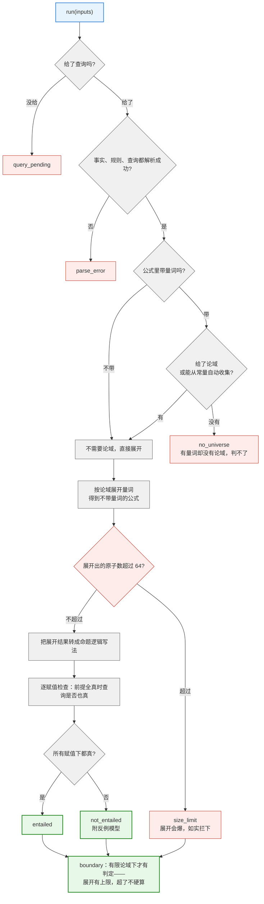
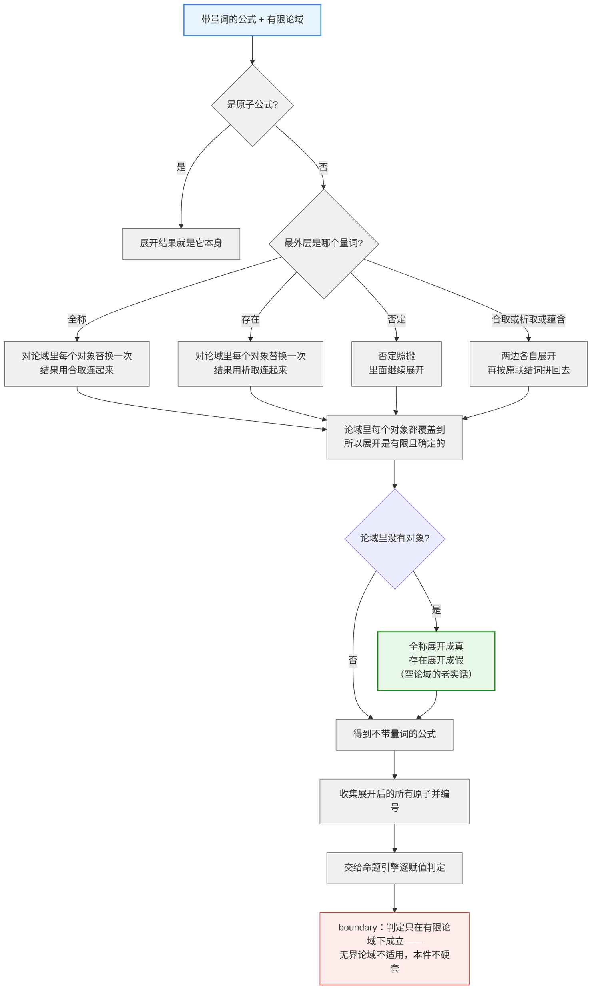

# 一阶判定 first_order — 逻辑流程图

> 模块：`engine/classical/first_order.py` · 层：第 1 层经典逻辑（带量词的判定，有限论域展开）
> 一句话：给一个**有限论域**，把带量词的公式**展开成不带量词的命题**，
> 交给命题引擎逐赋值判定——推得出就 `entailed`，推不出就 `not_entailed` **并给出反例模型**。
> 图 1 → `run()` 主流程：论域 → 展开 → 判定
> 图 2 → 量词展开的规则与两条拦阻（没论域 / 原子太多）
> 判据与写法约定见 `docs/diagrams/README.md`。

## 一、run(inputs) 主流程：论域有了才谈得上判定

## 二、量词怎么展开：全称展成合取，存在展成析取

## 三、对着代码核过的口径与边界

- **输入**（`PORTS['in']`）：`universe`（论域对象，可省——从事实常量自动收集）·
  `facts`（事实）· `rules`（规则）· `query`（要判的查询）。
- **判词**：`entailed` · `not_entailed` · `no_universe` · `size_limit` · `query_pending` ·
  `parse_error`。
- **判定的地基是"有限论域"**：量词按论域逐个对象展开（全称→合取、存在→析取），
  展开完就是命题问题，所以判定是**确定且可复核**的；**论域不有限就不适用**。
- **有量词却没有论域 → `no_universe`**：这时不猜、不默认一个论域，直接拦下——
  猜一个论域会凭空造出结论。
- **展开上限 `_MAX_GROUND_ATOMS = 64`**：原子太多就报 `size_limit`，
  **返回里带上实际原子数**，让人知道离上限有多远。
- **反例是模型**：`not_entailed` 会给一份**反例模型**（哪些原子取真、哪些取假），
  可以直接拿去复核，不用重跑。
- **空论域照实处理**：论域里一个对象都没有时，全称展开为真、存在展开为假
  （这是标准的老实话），代码里单独处理。
- **诚实边界**（`boundary` 字段随每个返回点带回）：本件是**有限域展开型**判定——
  无界量词不在适用范围；解析失败与超限都如实报；**只判蕴含关系，
  不判前提本身对不对，也不做取舍决策**。
