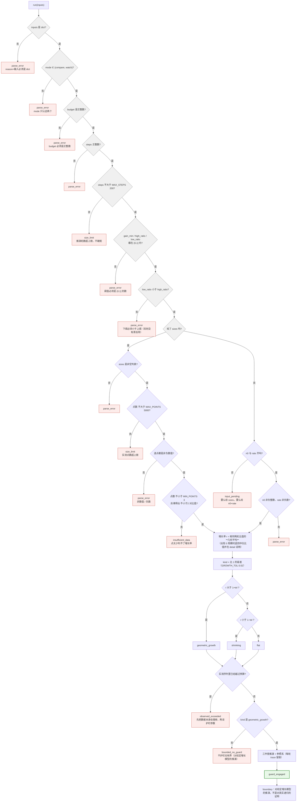

# 增长护栏 growth_guard — 逻辑流程图

> 模块：`engine/mechanisms/growth_guard.py` · 层：第 2 层机制
> 一句话：给"每轮产物规模 + 预算"，算增长率、限幅/增益调度/滞后补偿三件套的压制效果与**代价**
> （累计截断量 · 每轮最大跳变 · 开关抖动次数），以及"不截断需要多大预算"。
> 判据与写法约定见 `docs/diagrams/README.md`。

## 一、run(inputs) 主流程：先拦、再判、最后才推演



## 二、三件套各自的压制逻辑（同一张图的另一种读法）

```mermaid
flowchart TD
  subgraph "RAW[""参照系（不上护栏）"]
    R0["n ← ⌊r·n⌋"] --> R1["每轮乘倍数 → 指数增长"]
    R1 --> R2["报 exceeded_at（第几轮越界）"]
  end
  subgraph "CL[""限幅 clamp"]
    C0["want = ⌊r·n⌋"] --> C1["n ← min(want, B)"]
    C1 --> C2["cut_total += max(0, want − n)<br/>代价＝整块截断"]
  end
  subgraph "GA[""增益调度 gain"]
    G0["want_raw = ⌊r·n⌋"] --> G1{"want_raw 不大于 B ?"}
    G1 -->|是| G2["原样长（**不威胁预算就不动**）"]
    G1 -->|否| G3["g = min(1, max(g_min, 1 − n/B))<br/>want = ⌊n + g·(r−1)·n⌋"]
    G3 --> G4["逐步逼近 B，不是一步顶到上限"]
  end
  subgraph "HY[""滞后补偿 hysteresis"]
    H0{"介入中?"} -->|否| H1{"n 不小于 high ?"}
    H1 -->|是| H2["介入，switches += 1"]
    H0 -->|是| H3{"n 不大于 low ?"}
    H3 -->|是| H4["退出，switches += 1"]
    H1 -->|否| H5["带内：状态不变（这段就是滞后带）"]
    H3 -->|否| H5
    H2 --> H6["介入时按增益地板长：rate' = 1 + g_min·(r−1)"]
    H4 --> H7["退出后恢复原倍率"]
  end
  C2 --> SUM["policies：{trace, max_size, final_size,<br/>exceeded_at, switches, max_jump, cut_total}"]
  G4 --> SUM
  H6 --> SUM
  H7 --> SUM
  R2 --> CMP["recommendation：no_cut_budget / cut_needed /<br/>rounds_to_budget_*"]
  SUM --> CMP
  classDef core fill:#e8f4fd,stroke:#4a90d9,stroke-width:2px
  classDef tool fill:#f0f0f0,stroke:#666
  classDef out fill:#e8f8e8,stroke:#2d8c2d,stroke-width:2px
  classDef stop fill:#fdecea,stroke:#c0392b
  class R0,R1,R2 stop
  class C0,C1,C2 tool
```

## 三、对着代码核过的口径与边界

- **输入**（`PORTS['in']`）：`sizes` / `n0` / `rate` / `budget` / `steps` / `mode` / `gain_min` /
  `high_ratio` / `low_ratio`。
- **判定的每个出口**：`world` 侧＝`geometric_growth` / `flat` / `shrinking`；
  **判词**：`bounded_no_guard` · `guard_engaged` · `observed_exceeded` · `insufficient_data` ·
  `input_pending` · `parse_error` · `size_limit` · `internal_error`。
- **关键常量**：`MIN_POINTS=3` · `MAX_POINTS=5000` · `MAX_STEPS=200` · `DEFAULT_STEPS=20` ·
  `GROWTH_TOL=0.02` · `DEFAULT_GAIN_MIN=0.1` · `DEFAULT_HIGH=0.9` · `DEFAULT_LOW=0.6`。
- **留痕**：每条策略都给逐轮 `trace`；`max_jump` 把"起点到自己第一轮"那一跳也算进去
  （各策略起点必须同源）。
- **诚实边界**（`boundary` 字段随每个返回点带回）：限幅与增益都是**有损**的，本件只报代价、
  **不判砍掉的那部分要不要紧**；取整语义是 `⌊n·r⌋`（规模很小时增长会被取整抹平）；
  本件**没有"步长限幅"（速率限）**这一件——只报每轮最大跳变，不限它；只诊断不决策。
