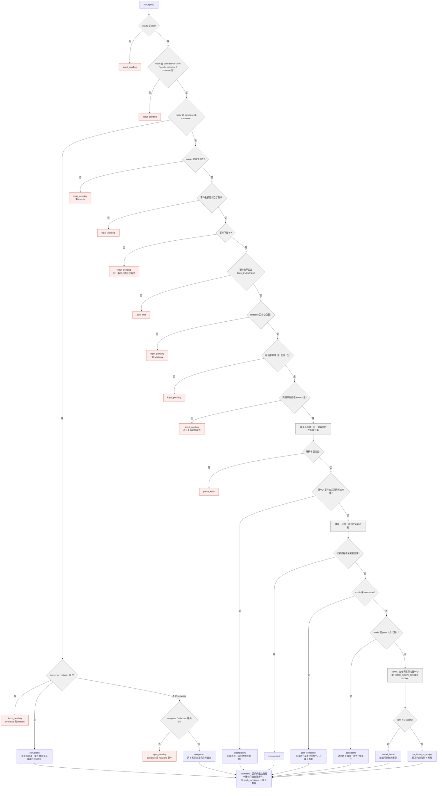
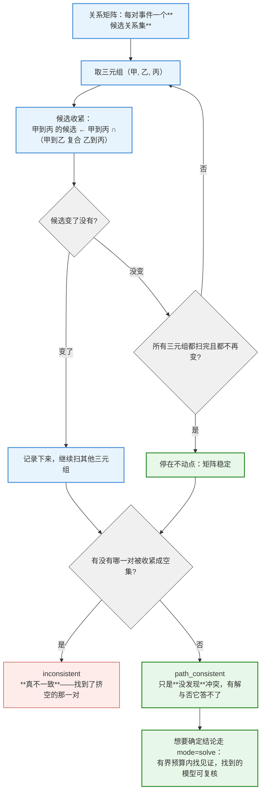

# 区间代数 interval_algebra — 逻辑流程图

> 模块：`engine/cold/interval_algebra.py` · 层：第 3 层（外部共识：Allen 1983 关系代数与路径一致性，归借鉴区）
> 一句话：给若干**事件**与它们之间的**定性时序关系**，判这套关系自不自洽、能不能找到具体排布；
> 也能算关系的**复合**与**逆**。
> 图 1 → `run()` 五种 mode 的主流程
> 图 2 → 路径一致性：逐对收紧，收紧到空集就是真不一致
> 判据与写法约定见 `docs/diagrams/README.md`。

## 一、run(inputs) 主流程

## 二、路径一致性：逐对收紧到不动（这是"必要条件"）

## 三、对着代码核过的口径与边界

- **输入**（`PORTS['in']`）：`mode` · `events`（事件名列表）· `relations`（`[甲, 关系, 乙]` 列表）·
  `relation`（compose / converse 用）。
- **判词**：`composed` · `conversed` · `consistent` · `path_consistent` · `inconsistent` ·
  `model_found` · `not_found_in_budget` · `input_pending` · `parse_error` · `size_limit`。
- **关键常量**：`MAX_EVENTS = 8` · `MAX_SOLVE_NODES = 200000`；基本关系 13 个（先于 / 相接 / 重叠 /
  开始于 / 包含于 / 结束于 / 同时 + 各自逆），另有 `REL_CN` 中文别名与本构件认识的各种写法（`ALIASES`）。
- **点代数**：`mode=point` 用三个点关系（`<` / `=` / `>`）＋ 各自的复合与逆表，
  **点代数上路径一致性是完备的**（所以那个模式给的是 `consistent` 而不是 `path_consistent`）。
- **诚实边界**（`boundary`）：**区间代数上路径一致性只给必要条件**——报 `inconsistent` 就是**真不一致**
  （找到了挤空的那一对）；报 `path_consistent` **只说明没发现冲突，不等于有解**；要确定结论用
  `mode=solve`（有界预算内找到的模型可复核）；**只做定性关系、不给数值**；
  见证搜索有界：**没找到 ≠ 无解**；只诊断不决策。
