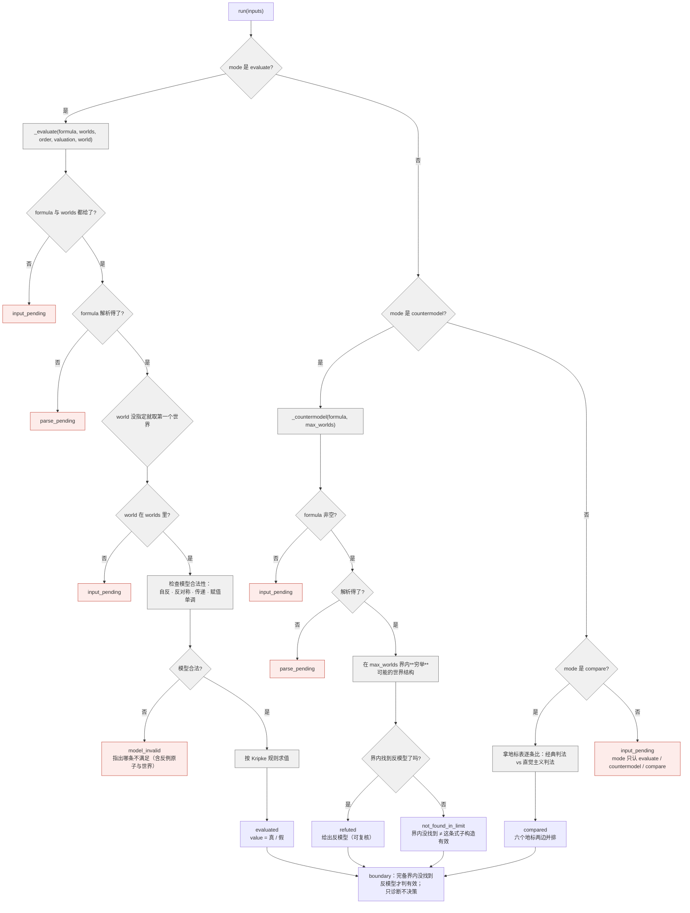
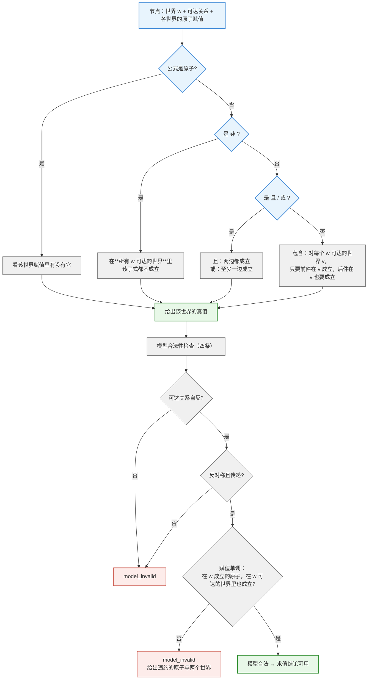

# 直觉主义逻辑 intuitionistic_logic — 逻辑流程图

> 模块：`engine/cold/intuitionistic_logic.py` · 层：第 3 层（外部共识：Brouwer / Heyting / Kripke 1959，归借鉴区）
> 一句话：**构造性立场**上的推理——在 Kripke 模型里求值、给反模型（"为什么排中律不是构造有效的"），
> 并把六个经典地标在**经典 vs 直觉主义**两边并排对照。
> 图 1 → `run()` 三种 mode 的主流程
> 图 2 → Kripke 求值规则与反模型搜索（含模型合法性检查）
> 判据与写法约定见 `docs/diagrams/README.md`。

## 一、run(inputs) 主流程

## 二、Kripke 求值规则与"模型必须合法"

## 三、对着代码核过的口径与边界

- **输入**（`PORTS['in']`）：`mode`（`evaluate` / `countermodel` / `compare`）· `formula` ·
  `worlds` · `order`（可达关系）· `valuation`（各世界的原子赋值）· `world` · `formulas` · `max_worlds`。
- **判词**：`evaluated` · `refuted` · `valid` · `compared` · `model_invalid` ·
  `not_found_in_limit` · `parse_pending` · `input_pending` · `size_limit`。
- **求值规则**（照着代码核的）：原子查赋值；`¬` 要在**所有可达世界**上子式不成立；
  `∧` / `∨` 照常；`→` 要看**每个可达世界**——只要前件成立，后件也得成立
  （这就是"构造性"的来源：真值不是"当前世界的一个标记"，而是**沿可达结构往后传**）。
- **模型合法性四条**：可达关系**自反 · 反对称 · 传递**，且赋值**单调**（在 w 成立的原子，
  在 w 可达的世界里也成立）——不满足就报 `model_invalid` 并指出违约处。
- **反模型搜索是**"**完备界内的穷举**"：界内找到 → `refuted`（反模型可复核）；
  界内没找到 → `not_found_in_limit`——**没找到 ≠ 构造有效**，这条不越界宣称。
- **地标对照表**（compare）：排中律 `P∨¬P` · 双重否定消去 `¬¬P→P` · Peirce 律
  `((P→Q)→P)→P` · 两条 De Morgan · 爆炸 `P→(Q→P)`——每条给出经典判法与直觉主义判法。
- **诚实边界**：只做**构造性立场上的求值与反模型搜索**；界内无解才判有效；
  经典与直觉主义**两边并排给**，不替使用者挑立场；只诊断不决策。
