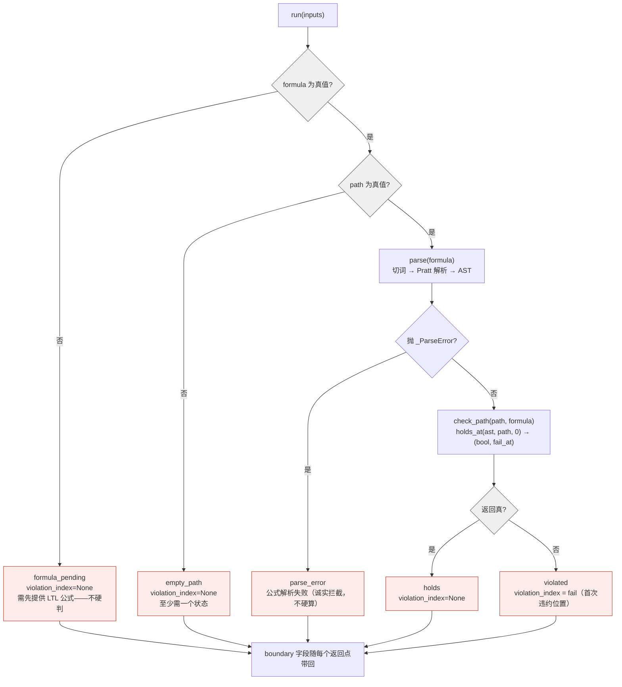

# 时序逻辑 LTL ltl — 逻辑流程图

> 模块：`engine/classical/ltl.py` · 层：第 1 层经典逻辑
> 一句话：给一条**有穷状态路径**和一个 LTL 公式（X 下一 / G 一直 / F 最终 / U 直到），
> 沿路径逐位置求值，判这条路径满不满足它；不满足就给出**首次违约的位置**。
> 判据与写法约定见 `docs/diagrams/README.md`。

## 一、run(inputs) 主流程：先查缺不缺参数，再解析，最后才沿路径求值



## 二、沿路径怎么算：每种算子各交回什么（违约位置从哪来）

```mermaid
flowchart TD
  subgraph "LEX[""切词与解析（_tokenize / _P.parse）"]
    A0["一元时态算子 X G F<br/>当最高优先级（与 ¬ 同级）<br/>子式按 parse(6) 递归"]
    A1["¬ 走 parse(6)"]
    A2["二元算子按 _PREC 决定结合：<br/>↔ 1 → → 2 → U 3 → ∨ 4 → ∧ 5"]
    A0 --> OK["AST 形如 (算子, 子式…)<br/>原子 = (atom, 名字)"]
    A1 --> OK
    A2 --> OK
    A0 --> ERR["缺左操作数 / 公式不完整 / 多余内容<br/>→ raise _ParseError"]
  end
  subgraph "EVAL[""求值 holds_at(ast, path, i) → (bool, fail_at)"]
    E0["atom：名字在 path[i] 原子集里?"]
    E1["¬：子式取反，fail 原样透传"]
    E2["∧：左边假就直接返回左边的 fail；否则算右边"]
    E3["∨：左边真就直接真且 fail=None；否则算右边"]
    E4["→：左边假即真；否则算右边"]
    E5["↔：两边都算，同真同假才真，fail 记 i"]
    E6["X：i+1 超出路径 → 判假且 fail 记 i（尽头无下一状态）"]
    E7["G：从 i 扫到末尾，第一个不满足处违约<br/>fail 取子式给的失败位置，否则取 j"]
    E8["F：从 i 扫到末尾找满足；<br/>全程不满足 → 假，fail 记 len(path)-1"]
    E9["U：从 i 找第一个 ψ 真的 j；<br/>先核 [i,j) 全为 φ，中途假就违约；<br/>走到末尾ψ从未真 → 假，fail 记 len(path)-1"]
  end
  OK --> E0
  E0 --> VAL{"整条路径从 0 起的真假"}
  E1 --> VAL
  E2 --> VAL
  E3 --> VAL
  E4 --> VAL
  E5 --> VAL
  E6 --> VAL
  E7 --> VAL
  E8 --> VAL
  E9 --> VAL
  VAL --> OUT["holds（violation_index=None）<br/>或 violated（violation_index=fail）"]
  classDef core fill:#e8f4fd,stroke:#4a90d9,stroke-width:2px
  classDef tool fill:#f0f0f0,stroke:#666
  classDef out fill:#e8f8e8,stroke:#2d8c2d,stroke-width:2px
  classDef stop fill:#fdecea,stroke:#c0392b
  class OUT out
```

## 三、对着代码核过的口径与边界

- **输入**（`PORTS['in']`）：`path`（`list?`，状态序列，每状态 = 原子命题为真的集合或 dict）·
  `formula`（`str`）。注意 `path` 在 PORTS 里标了可选，但 `run` 里它是**硬要求**——空路径直接
  给 `empty_path`。
- **判词**（全在源码里，逐字照抄）：`holds` · `violated` · `formula_pending` · `empty_path` ·
  `parse_error`。本件**没有** `size_limit`、也没有 `internal_error`：走到求值这一步就没有别的
  拦法了，抛出的只有 `_ParseError` 一种。
- **返回字段**（`PORTS['out']`）：`verdict` · `violation_index` · `boundary`。
- **关键常量**：`_TEMP1 = {'X','G','F'}`（一元时态，解析时按 `parse(6)` 吃子式）·
  `_BIN = {'∧','∨','→','↔','U'}`（U 跟联结词同表，靠 `_PREC['U'] = 3` 定结合）· `_UN = {'¬'}` ·
  `_PREC = {'↔':1, '→':2, 'U':3, '∨':4, '∧':5}`。
- **留痕**：只有 `violation_index` 一个位置数字，**不给反例路径本身**（也知道在哪一步违约，
  但路径是调用者自己给的，不再回抄一遍）。
- **诚实边界**（`boundary` 随每个返回点带回）：只做**有穷路径**判定；`F` 在路径走完之后仍未
  满足时报的是"有界路径内未满足"（`fail = len(path)-1`），**不是**"永不"这个无穷判定——
  这一句在 `violated` 的 boundary 里明写；只判经典线性时间语义，**不含 CTL 路径量词**
  （E/A 那一套是 `model_check` 的事，本件不做自动机翻译）；只诊断不决策。
