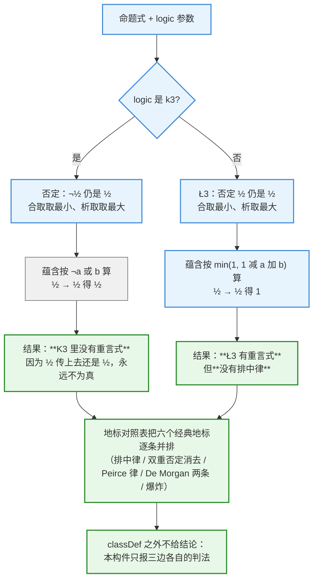

# 多值逻辑 many_valued — 逻辑流程图

> 模块：`engine/cold/many_valued.py` · 层：第 3 层（外部共识：Kleene 强三值 / Łukasiewicz 三值，归借鉴区）
> 一句话：三值世界里的**重言式与有效性**——K3 的 ½ 是"未知"、Ł3 的 ½ 是"中间真值"，
> 同一句 `P→P` 在两套里判法都不同，所以本构件**两套并排给，附经典对照**。
> 图 1 → `run()` 四种 mode 的主流程
> 图 2 → 两套三值的差别（这是本件最值钱的一口）
> 判据与写法约定见 `docs/diagrams/README.md`。

## 一、run(inputs) 主流程

```mermaid
flowchart TD
  IN["run(inputs)"] --> V1{"inputs 是 dict?"}
  V1 -->|否| R1["input_pending"]
  V1 -->|是| V2{"logic 是 k3 或 l3?"}
  V2 -->|否| R2["input_pending<br/>只认 k3（默认）/ l3"]
  V2 -->|是| M0{"mode 没给?"}
  M0 -->|是| M1["按有没有给指派推断 mode"]
  M0 -->|否| M2{"mode 在 evaluate / tautology / validity / compare 里?"}
  M1 --> M2
  M2 -->|否| R3["input_pending"]
  M2 -->|是| C1{"mode 是 compare?"}
  C1 -->|是| C2["拿内置地标表逐条求值：<br/>排中律 · 双重否定 · Peirce 律 · 两条 De Morgan · 爆炸"]
  C2 --> O1["compared<br/>每条在 K3 / Ł3 / 经典 三边并排"]
  C1 -->|否| F1{"mode 是 validity?"}
  F1 -->|是| F2{"premises 与 conclusion 都给了?"}
  F2 -->|否| R4["input_pending<br/>validity 需要前提与结论"]
  F2 -->|是| F3["解析前提与结论"]
  F3 --> F4["收集原子，数不超过 MAX_ATOMS 8?"}
  F4 -->|否| R5["size_limit"]
  F4 -->|是| F5["穷举所有三值指派：<br/>前提全为真 且 结论不为真 → 反例"]
  F5 --> F6{"找到反例了吗?"}
  F6 -->|是| O2["invalid<br/>给出反例指派"]
  F6 -->|否| O3["valid<br/>所有指派下都保真"]
  F1 -->|否| G1{"formula 非空?"}
  G1 -->|否| R6["input_pending"]
  G1 -->|是| G2{"解析有语法错?"}
  G2 -->|是| R7["parse_error"]
  G2 -->|否| G3["收集原子，数不超过 MAX_ATOMS 8?"}
  G3 -->|否| R8["size_limit"]
  G3 -->|是| G4{"mode 是 evaluate?"}
  G4 -->|是| E1{"assignment 是 dict 吗?"}
  E1 -->|否| R9["input_pending<br/>诚实拦截"]
  E1 -->|是| E2{"指派合法（原子 → 1 / ½ / 0）?"}
  E2 -->|否| R10["input_pending"]
  E2 -->|是| E3["按该 logic 的三值真值表求值"]
  E3 --> O4["evaluated<br/>给出真值（真 / 未知 / 假）"]
  G4 -->|否| T1["穷举所有指派：只要有一个不为真就不是重言式"]
  T1 --> T2{"全为真?"}
  T2 -->|是| O5["tautology"]
  T2 -->|否| O6["not_tautology<br/>给出反例指派"]
  O1 --> BND["boundary：两套三值并排给，<br/>不合并成一个结论"]
  O2 --> BND
  O3 --> BND
  O4 --> BND
  O5 --> BND
  O6 --> BND
  classDef core fill:#e8f4fd,stroke:#4a90d9,stroke-width:2px
  classDef tool fill:#f0f0f0,stroke:#666
  classDef out fill:#e8f8e8,stroke:#2d8c2d,stroke-width:2px
  classDef stop fill:#fdecea,stroke:#c0392b
  class R1,R10,R2,R3,R4,R5,R6,R7,R8,R9 stop
  class C1,C2,E1,E2,E3,F1,F2,F3,F4,F5,F6,G1,G2,G3,G4,M0,M1,M2,T1,T2,V1,V2 tool
```

## 二、K3 与 Ł3 的差别：同一句话两套判法



## 三、对着代码核过的口径与边界

- **输入**（`PORTS['in']`）：`logic`（`k3` / `l3`）· `mode`（`evaluate` / `tautology` / `validity` /
  `compare`）· `formula` · `assignment`（原子 → 1 / ½ / 0）· `premises` · `conclusion`。
- **判词**：`evaluated` · `tautology` · `not_tautology` · `valid` · `invalid` · `compared` ·
  `input_pending` · `parse_error` · `size_limit`。
- **关键常量**：`MAX_ATOMS = 8` · `TRUE, UNK, FALSE = 1.0, 0.5, 0.0` · `_VALUE_CN`（真/未知/假的读法）。
- **两套的差别写进常量注释**（照抄）：K3 的蕴含是 `¬a∨b`，`½→½ = ½`，所以 **K3 没有重言式**；
  Ł3 的蕴含是 `min(1, 1−a+b)`，`½→½ = 1`，所以 **Ł3 有重言式但没有排中律**。
- **地标表**（compare 模式逐条并排）：排中律 `P∨¬P` · 双重否定消去 `¬¬P→P` ·
  Peirce 律 `((P→Q)→P)→P` · `¬(P∧Q)→(¬P∨¬Q)` · `¬(P∨Q)→(¬P∧¬Q)` · 爆炸 `P→(Q→P)`。
- **诚实边界**：**两套三值并排给**，不合并成一个结论；非经典的值只做真值表层面的推理，
  **不替使用者挑哪套对**；原子超上限报 `size_limit` 不硬跑；只诊断不决策。
