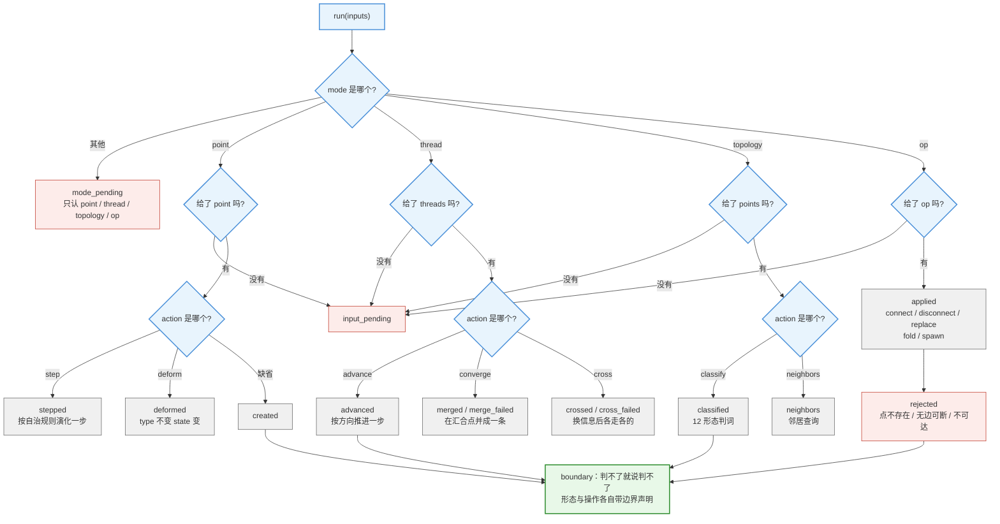
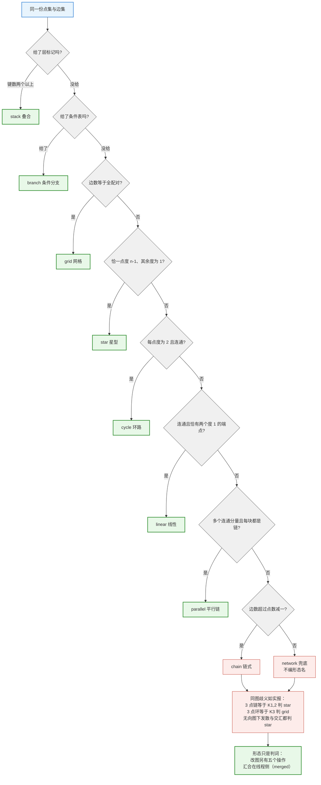

# MT-MP-TL 骨架 mtmp — 逻辑流程图

> 模块：`engine/skeleton/mtmp.py` · 层：第 0 层骨架（点 / 线程 / 拓扑 / 操作）
> 一句话：一套通用骨架——**点**按自治规则演化，**线程**按方向有序推进，
> **拓扑**判 12 种形态，**操作**按定义改图；判不了的一律标出来，不硬判。
> 图 1 → `run()` 四个模式的分派与各自的第一道校验
> 图 2 → 12 形态的判定顺序（可判 / 需元数据 / 同图歧义）
> 判据与写法约定见 `docs/diagrams/README.md`。

## 一、run(inputs) 主流程：四个模式分派，各自先拦一道

## 二、12 形态的判定顺序：可判的严格判，要元数据的等元数据

## 三、对着代码核过的口径与边界

- **输入**（`PORTS['in']`）：`mode`（`point` / `thread` / `topology` / `op`）· `point` · `threads` ·
  `points` · `edges` · `op` · `a` · `b` · `kappa` · `verbose`。
- **判词**（14 个）：`created` · `stepped` · `deformed` · `advanced` · `merged` · `merge_failed` ·
  `crossed` · `cross_failed` · `classified` · `neighbors` · `applied` · `rejected` ·
  `input_pending` · `mode_pending`。
- **点**：`state` 的演化由该点的自治规则决定（有规则才 `stepped`，没规则就如实返回）；
  `deform` 保持 `type` 不变、只改 `state`。
- **线程**：`direction` 定方向（反向线程按倒序访问），`speed` 是单位时间经过的节点数，
  `phase` 是相位差；
  汇合（`merged`）与交叉（`crossed`）是两件事——**交叉不合并成一条**。
- **形态判定的诚实口径**（对着代码核过）：
  - `stack` 只在**给了层标记且键数不少于 2** 时判——判据看的是"有没有层标记"，
    **不校验层号是否真的不同**；所以同一批点全填同一层号，也会判成 `stack`。
  - `diverge`（发散）与 `converge`（交汇）两分支的条件**互相蕴含**，而 `diverge` 排在前面，
    因此 `converge` 的判词实际取不到；**同一张无向图，单源多出与多入单出都先判到 `star`**。
    要分开这两者，必须另外给出**有向**信息（方向来自线程的方向）。
  - 三个节点以内的链与环会与星型 / 全连接同图（见上图），所以形态判词要**连边集一起看**。
- **操作口径**：`op` 模式认 `connect` / `disconnect` / `replace` / `fold` / `spawn`；
  `converge` 落在**线程侧**（`merged`），不在 `op` 模式里。
  `fold` 按实现是**加一条直连把距离压到一跳**——注意这与"折叠只改距离、不改连接关系"
  的读法不同，用的时候照实现理解（本件已在 `boundary` 里声明，不藏）。
- **诚实边界**（`boundary` 字段随每个返回点带回）：判不了就返回 `input_pending` /
  `mode_pending`，不猜；形态里语义型的（叠合 / 条件分支）没有元数据时不硬判；
  **本件只做结构判定，不做矛盾判定、不做决策**。
