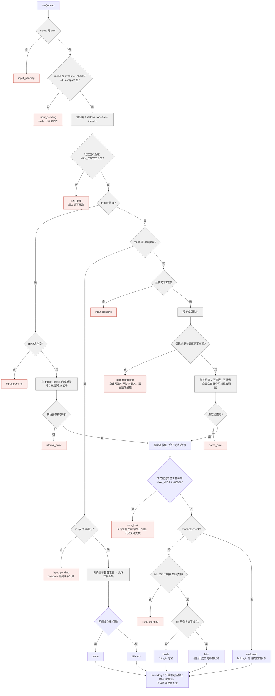
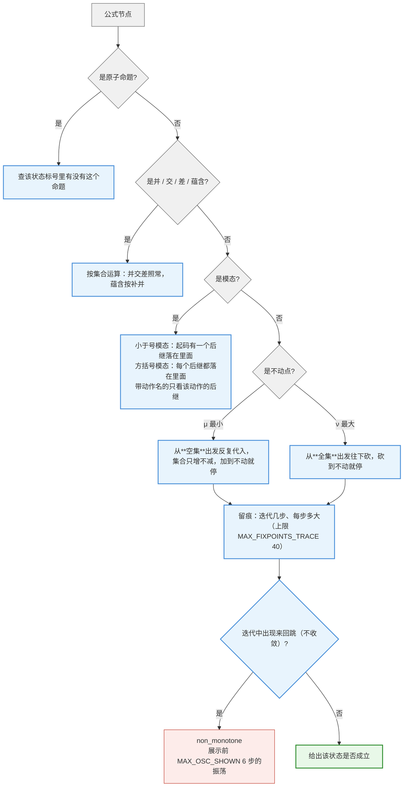

# 模态 μ 演算 mu_calculus — 逻辑流程图

> 模块：`engine/cold/mu_calculus.py` · 层：第 3 层（外部共识：Kozen 1983 · Knaster-Tarski · Emerson-Jutla，归借鉴区）
> 一句话：给一个**有限迁移系统**和一个**μ 演算公式**，算出公式在**哪些状态上成立**——
> μ 从空集往上加、ν 从全集往下砍，**每一步留痕**；CTL 的八个路径量子能翻成 μ 式子复核。
> 图 1 → `run()` 四种 mode 的主流程
> 图 2 → 求值内核：两个不动点怎么迭代（外加"负出现"怎么被拦下）
> 判据与写法约定见 `docs/diagrams/README.md`。

## 一、run(inputs) 主流程：四种 mode 共用一个求值内核

## 二、求值内核：两个不动点 + 一根"负出现"的红线

## 三、对着代码核过的口径与边界

- **输入**（`PORTS['in']`）：`mode` · `formula` · `ctl` · `c1` / `c2`（compare 用）· `states` ·
  `transitions` · `labels`（每个状态上的原子命题）· `init`（check 用）。
- **判词**：`evaluated` · `holds` · `fails` · `same` · `different` · `non_monotone` ·
  `input_pending` · `parse_error` · `size_limit` · `internal_error`。
- **关键常量**：`MAX_STATES = 200` · **`MAX_WORK = 400000`**（整次判定的工作量上限——光卡分支数不够，
  式子照样能卡死）· `MAX_FIXPOINTS_TRACE = 40` · `MAX_OSC_SHOWN = 6`。
- **留痕**：`fixpoints` 记每轮迭代的集合大小——"只迭代一轮就停""从全集出发"这类错一眼看得出。
- **CTL 复核**：`mode=ctl` 先翻译再求值，`translation` 字段带出翻出来的 μ 式子。
- **诚实边界**：**只做给定结构上的求值与检查**（model checking）——不是逻辑普遍有效，
  **更不做"公式有没有模型"的可满足性判定**；不动点变量必须**正出现**（负出现没有不动点语义，
  会拦下并摆出振荡过程）；状态数/工作量有上限，超了报 `size_limit` 不硬跑；
  交替更深的性质 CTL 写不出来（Emerson-Jutla），本构件**不证这件事、只标来源**。
