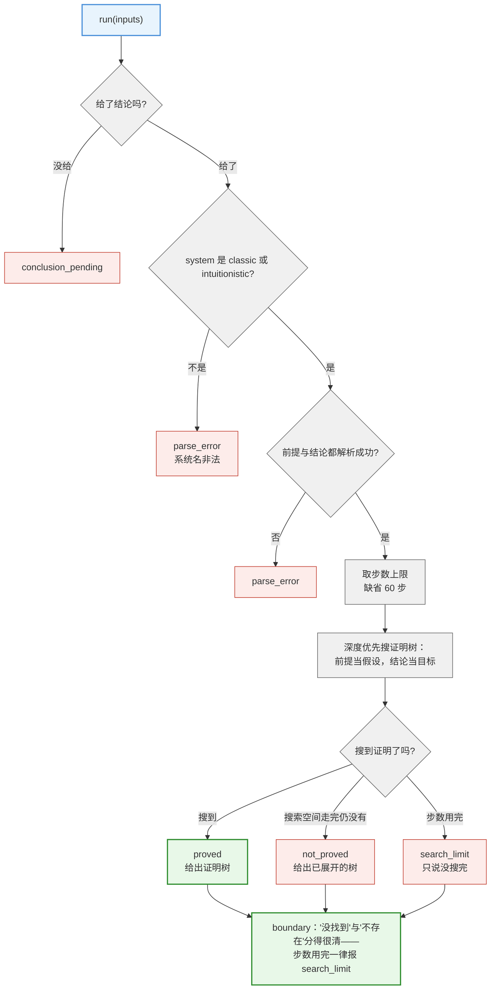
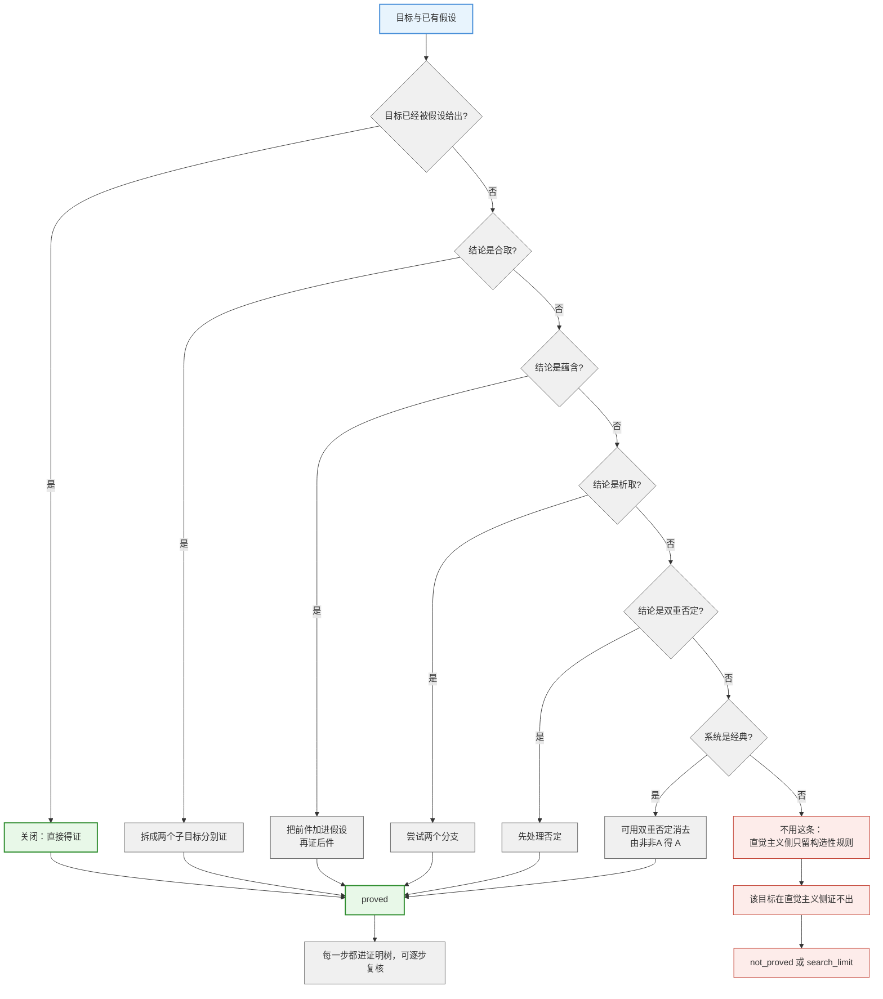

# 自然演绎 nd_propositional — 逻辑流程图

> 模块：`engine/classical/nd_propositional.py` · 层：第 1 层经典逻辑（自然演绎证明搜索）
> 一句话：给前提与结论，按自然演绎规则**搜一棵证明树**——证到了就 `proved` 并给出树，
> 搜完没找到就 `not_proved`，搜到上限就 `search_limit`（**不把"没找到"说成"不存在"**）。
> 图 1 → `run()` 主流程与三种出口
> 图 2 → 两套系统的分叉：经典多一条"双重否定消去"
> 判据与写法约定见 `docs/diagrams/README.md`。

## 一、run(inputs) 主流程：给结论 → 选系统 → 搜证明树

## 二、两套系统的差别：经典比直觉主义多一条双重否定消去

## 三、对着代码核过的口径与边界

- **输入**（`PORTS['in']`）：`premises`（前提列表）· `conclusion`（结论）·
  `system`（`classical` 默认 / `intuitionistic`）· `max_steps`（步数上限，默认 60）。
- **判词**：`proved` · `not_proved` · `search_limit` · `conclusion_pending` · `parse_error`。
- **三种出口分得很清**（这是本件最要紧的一条纪律）：
  - `proved`：真的搜到了，附**证明树**，每一步都能对着规则核；
  - `not_proved`：搜索空间走完了仍没有——**"在这套规则下没搜到"**，附已展开的树；
  - `search_limit`：步数用完——**只说"没搜完"**，不说"证不出"。后两者不能互相冒充。
- **两套系统的差别只有一条**：`classical` 多一条**双重否定消去**（由"非非 A"得 A），
  `intuitionistic` 不留这条，只保留构造性规则。所以同一对前提与结论，
  换系统可能从 `proved` 变成 `not_proved`——这是**有意为之**，不是不稳定。
- **每一步都留痕**：证明树与已展开的树都会随返回值给出（`proof_tree`），
  复核不用重跑搜索。
- **诚实边界**（`boundary` 字段随每个返回点带回）：本件是**搜索型**证明，
  证到就给树、搜不完就报上限，**不宣称"该结论成立"或"不成立"，
  也不替使用者决定用哪套系统**（系统名是调用方给的参数）。
