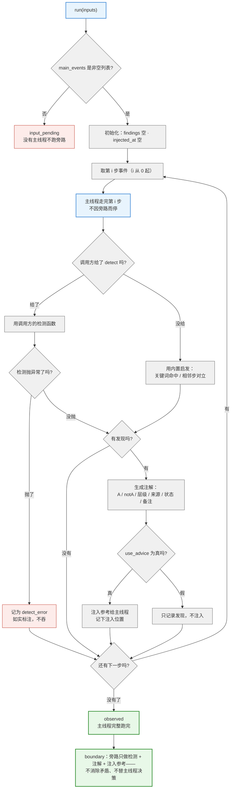
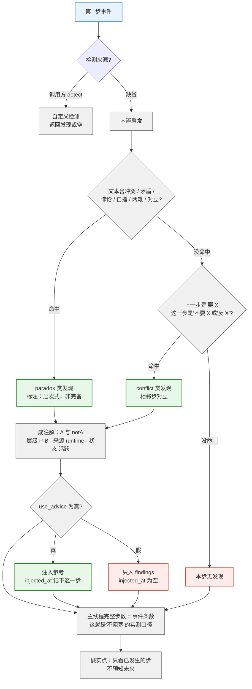

# 全程自反旁路 observer_bypass — 逻辑流程图

> 模块：`engine/mechanisms/observer_bypass.py` · 层：第 2 层机制（系统级旁路）
> 一句话：主线程照常推进，**矛盾观察走旁路线程**——检测到矛盾/自指就注解并注入参考，
> **主带不停**。不是宣称判定了矛盾，而是"矛盾观察不阻塞主流程"。
> 图 1 → `run()` 主流程：逐步推进 + 同步旁路观察 + 注入参考
> 图 2 → 检测来源两条路与"不阻塞"的实测口径
> 判据与写法约定见 `docs/diagrams/README.md`。

## 一、run(inputs) 主流程：主线程不停，旁路随行

## 二、检测来源两条路：一条交给自己，一条内置启发

## 三、对着代码核过的口径与边界

- **输入**（`PORTS['in']`）：`main_events`（主线程事件序列，每步一句描述）·
  `detect`（检测函数 `event -> 发现或 None`，缺省用内置启发）· `use_advice`（默认真）。
- **判词**：`observed` · `input_pending`（缺主线程事件时如实拦下）。
- **输出**：`main_ran`（主线程完整步数）· `findings`（每项带位置 / 类型 / 注解 / 是否注入）·
  `injected_at`（注入发生的主线程位置）。
- **"不阻塞"怎么算数**：`main_ran` 等于事件条数——旁路只观察，不改变主事件序列本身；
  主线程是否采纳注入参考，由主线程策略决定（本件**只给参考，不做主线程的决策**）。
- **检测是启发式的**：内置只做关键词命中与相邻步对立，**不是完备判定**，
  命中与未命中都如实标注；调用方可以换成自己的 `detect`，异常会被记成 `detect_error`
  而不是吞掉。
- **不预知未来**：第 i 步的检测只看已经发生的 i 步（`main_events[:i]`），
  所以"注入"发生在检测点之后，白箱可见。
- **诚实边界**（`boundary` 字段随每个返回点带回）：旁路观察 = 检测 + 注解 + 注入参考，
  **既不消除矛盾，也不替代主线程做判断**；本件判的是"观察有没有阻塞主流程"，
  不是"矛盾是否被判定了"。
