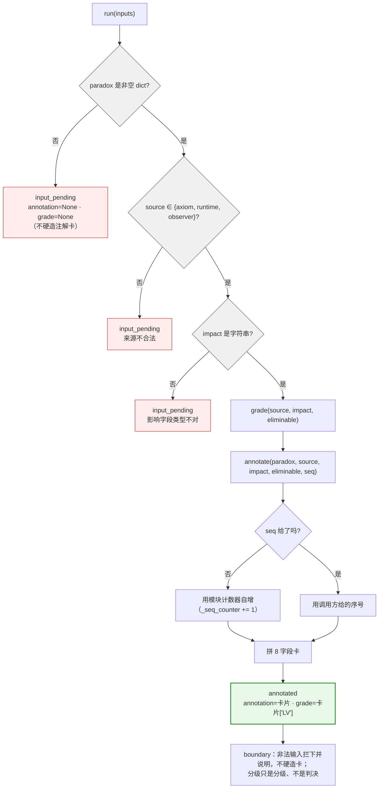
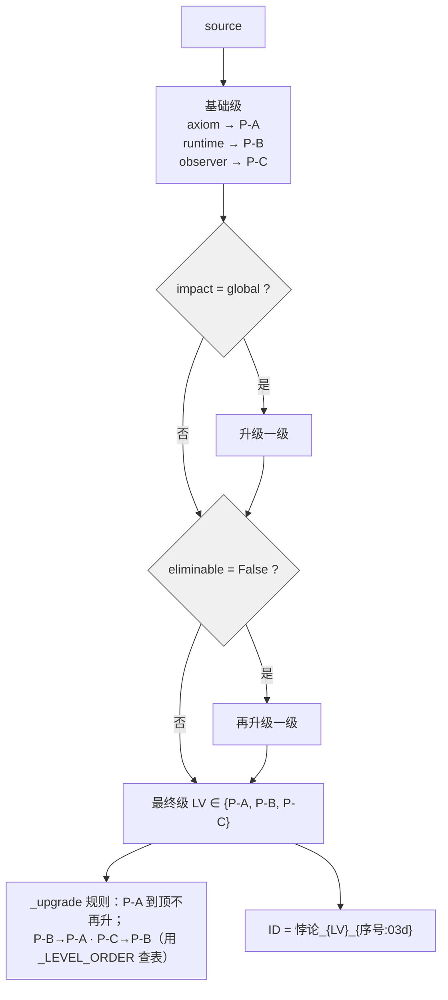

# 悖论注解 paradox_annotate — 逻辑流程图

> 模块：`engine/mechanisms/paradox_annotate.py` · 层：第 2 层机制
> 一句话：给一条矛盾生成**8 字段注解卡**（ID/LV/POS/SRC/CT/EF/ST/AN）并按来源与影响
> 分出 **P-A / P-B / P-C** 三级——矛盾拿一张"身份证"。
> 判据与写法约定见 `docs/diagrams/README.md`。

## 一、run(inputs) 主流程：三条拦截 → 定级 → 出卡

## 二、分级规则（`grade`）：基础级 → 两次升级

## 三、对着代码核过的口径与边界

- **输入**（`PORTS['in']`）：`paradox`（`{A, notA, pos, src, effect, note}`，可含 `coexist`）·
  `source`（`axiom` / `runtime` / `observer`）· `impact`（`local` / `global`）·
  `eliminable`（bool）· `seq`（序号，缺省自增）。
- **判词**：`annotated` · `input_pending`（三条拦截：paradox 非 dict/空 · source 不合法 ·
  impact 类型不对）。
- **卡片 8 字段**：`ID`（`悖论_P-?_NNN`）· `LV`（分级）· `POS`（位置：系统+层级+点位）·
  `SRC`（来源/触发链）· `CT`（内容：`A=…, ¬A=…, 共存形式=…`）· `EF`（影响的下游系统）·
  `ST`（状态，默认"活跃"）· `AN`（注解自由文本）。
- **关键表**：`_SOURCE_TO_BASE = {axiom→P-A, runtime→P-B, observer→P-C}` ·
  `_LEVEL_ORDER = {P-A:0, P-B:1, P-C:2}`。
- **留痕**：卡片 `ID` 里带分级与序号——同一批材料的卡能按序号对齐复核。
- **诚实边界**（`boundary`）：非法输入拦下并说明，**不硬造注解卡**；分级只是分级、
  **不是判决**；只诊断不决策。
