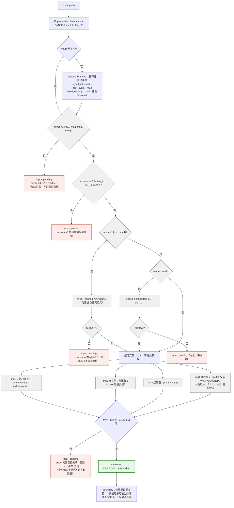

# 悖论测度 paradox_measure — 逻辑流程图

> 模块：`engine/mechanisms/paradox_measure.py` · 层：第 2 层机制（旗舰构件）
> 一句话：给矛盾两边的**证据权重**（或跨层张力、熵），算出悖论强度 μ ∈ [0,1]——
> 矛盾有多尖锐，一个数说清；四个分支 mu1/mu2/mu3/mu4 各有自己的算法。
> 判据与写法约定见 `docs/diagrams/README.md`。

## 一、run(inputs) 主流程：自动路由 → 逐层校验 → 算出 μ → 自检



## 二、四个分支各自算什么（自动路由那一步展开）

```mermaid
flowchart TD
  FEAT["路由特征"] --> Q1{"is_self_ref ?"}
  Q1 -->|是| B2["mu2 自指型<br/>X = ¬X ⇒ μ = 1.0"]
  Q1 -->|否| Q2{"has_layers ?"}
  Q2 -->|是| B3["mu3 层级型<br/>μ = |τ_L1 − τ_L2|<br/>（需两个跨层真值）"]
  Q2 -->|否| Q3{"need_entropy ?"}
  Q3 -->|是| B4["mu4 熵权型<br/>p = wA/(wA+wNotA)<br/>μ = −(p·log₂p + (1−p)·log₂(1−p))"]
  Q3 -->|否| B1["mu1 证据权重型（默认）<br/>μ = 1 − |wA−wNotA| / (wA+wNotA+ε)<br/>五五开 ⇒ μ=1；一边倒 ⇒ μ→0"]
  B1 --> PRIO["优先级：mu2 大于 mu3 大于 mu4 大于 mu1<br/>（更"尖锐"的形态优先认）"]
  B2 --> PRIO
  B3 --> PRIO
  B4 --> PRIO
  classDef core fill:#e8f4fd,stroke:#4a90d9,stroke-width:2px
  classDef tool fill:#f0f0f0,stroke:#666
  classDef out fill:#e8f8e8,stroke:#2d8c2d,stroke-width:2px
  classDef stop fill:#fdecea,stroke:#c0392b
  class Q1,Q2,Q3 tool
```

## 三、对着代码核过的口径与边界

- **输入**（`PORTS['in']`）：`mode` · `wA` · `wNotA` ·（另有 `proposition` / `tau_L1` / `tau_L2` /
  路由特征 `is_self_ref` / `has_layers` / `need_entropy`，见 run 实际取用）。
- **判词**：`measured` · `input_pending`（四条拦截路：未知 mode · mu3 缺跨层真值 ·
  权重/真值非法 · 自检越界）。
- **关键常量**：`EPS = 1e-9`（mu1 分母防零）· `TOL = 1e-6`（mu4 边界容差，注释写明"须覆盖 EPS
  造成的偏移，取 1e-6 保证 P8：p→1 时 μ→0，同时不误伤中段"）。
- **留痕**：返回带 `branch`（实际走的分支）与 `proposition`，便于复核"这条 μ 是谁算的"。
- **诚实边界**（`boundary`）：权重是**证据度量**，负值/非数值无意义——非法输入一律拦截、
  **不编造数值**；μ 只描述"矛盾在当前证据下有多尖锐"，**不是对错判决**；只诊断不决策。
