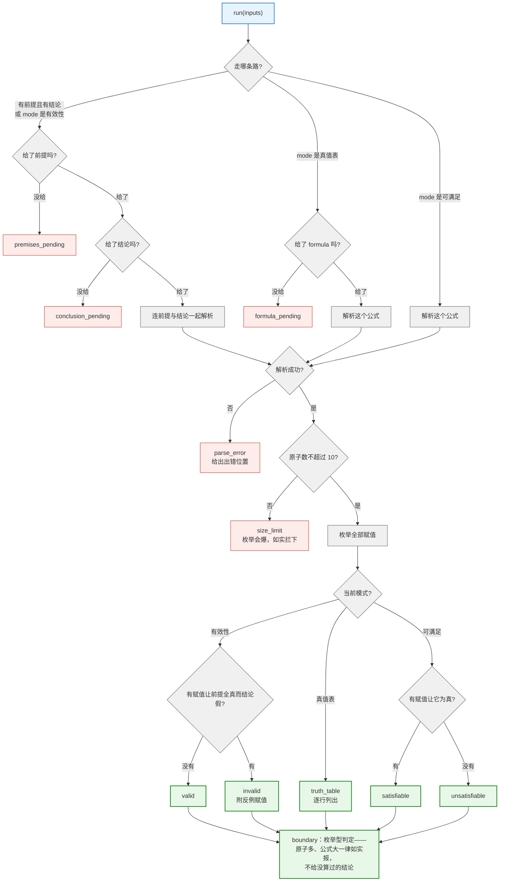
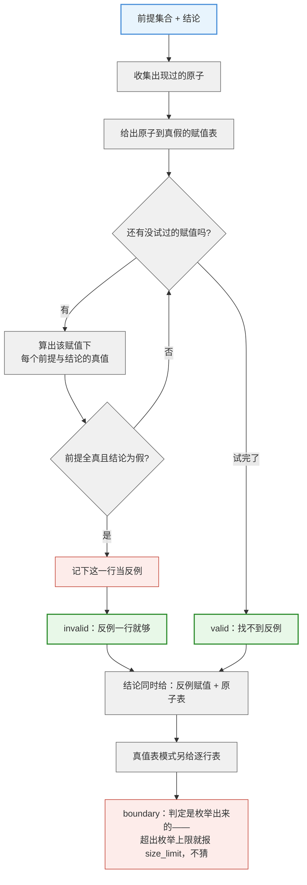

# 命题逻辑 propositional — 逻辑流程图

> 模块：`engine/classical/propositional.py` · 层：第 1 层经典逻辑（命题真值表）
> 一句话：把公式枚举**全部赋值**算真值表，据此判**有效性**（前提能否推出结论）、
> **可满足性**、以及公式是不是重言式 / 矛盾式；原子太多就如实拦下，不硬算。
> 图 1 → `run()` 三条路与四道拦（缺前提 / 缺结论 / 解析失败 / 规模超限）
> 图 2 → 有效性是怎么判的，反例从哪来
> 判据与写法约定见 `docs/diagrams/README.md`。

## 一、run(inputs) 主流程：三条路，四道拦

## 二、有效性怎么判：反例就是"前提全真、结论为假"的那一行

## 三、对着代码核过的口径与边界

- **输入**（`PORTS['in']`）：`formula`（单个公式）· `premises`（前提列表）· `conclusion`（结论）·
  `mode`（`validity` / `truth_table` / `satisfiable`，也可由"给了前提与结论"自动走有效性）。
- **判词**：`valid` · `invalid` · `truth_table` · `satisfiable` · `unsatisfiable` ·
  `parse_error` · `size_limit` · `premises_pending` · `conclusion_pending` · `formula_pending`。
- **契约**：`_CONNECTIVES` 认 `¬ ∧ ∨ → ↔`；优先级 `↔ 小于 → 小于 ∨ 小于 ∧`（数值越大结合越紧）。
- **规模上限**：`_MAX_ATOMS = 10`——原子超过 10 个，赋值组合会爆，直接报 `size_limit`
  并把原子数列出来，**不硬算**。
- **反例是判定的副产品**：`invalid` 一定带一个反例赋值（前提全真而结论假的那一行），
  可以直接拿去复核；`valid` 则不给反例。
- **无前提 / 无结论**是两件不同的事，分别报 `premises_pending` 与 `conclusion_pending`，
  这样调用方知道缺的是哪一半。
- **诚实边界**（`boundary` 字段随每个返回点带回）：本件是**枚举型**判定——给的都是
  算过的结果；解析失败报 `parse_error` 并指出位置；**只判真值与可满足性，
  不管公式"该不该写"，也不做任何取舍决策**。
