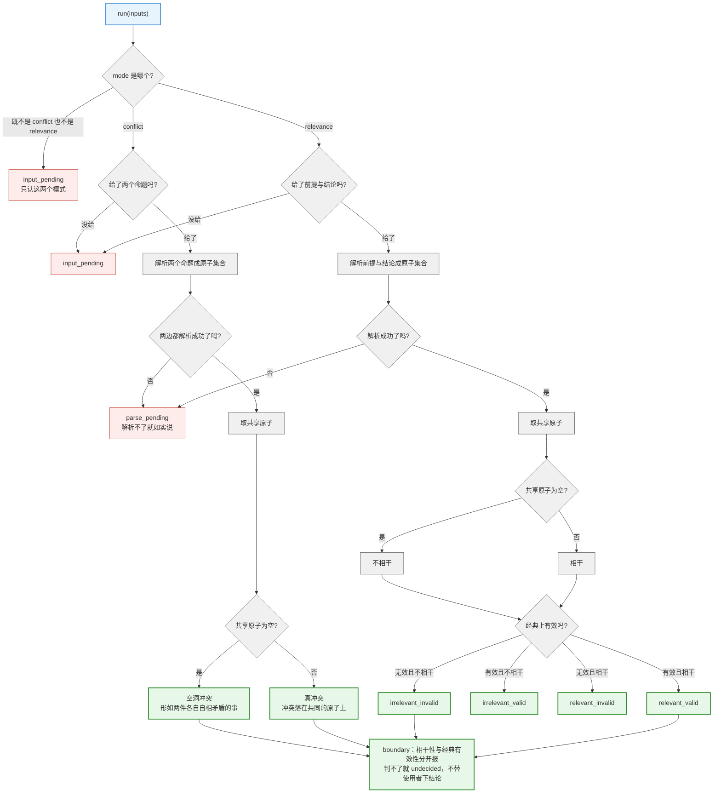
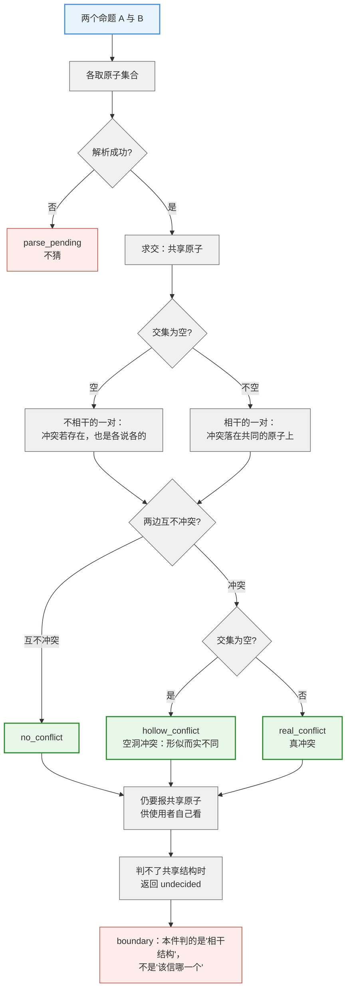

# 相干逻辑 relevance_logic — 逻辑流程图

> 模块：`engine/cold/relevance_logic.py` · 层：第 3 层冷门逻辑（相干性）
> 一句话：问两件事——**前提与结论有没有共享原子**（相干），以及**两个命题是真冲突还是空洞冲突**。
> 相干与否，与"经典上有没有效"是**两个维度**，本件把两个维度都报出来。
> 图 1 → `run()` 两个模式与相干四态（相干 × 有效）
> 图 2 → 冲突定性：真冲突与空洞冲突怎么分开
> 判据与写法约定见 `docs/diagrams/README.md`。

## 一、run(inputs) 主流程：相干四态是两个维度的交叉

## 二、冲突定性：先看共享原子，再看各自是不是自相矛盾

## 三、对着代码核过的口径与边界

- **输入**（`PORTS['in']`）：`mode`（`relevance` / `conflict`）· `premises`（前提列表）·
  `conclusion`（结论）· `prop_a` · `prop_b`（冲突模式的两个命题）。
- **判词**：`relevant_valid` · `relevant_invalid` · `irrelevant_valid` · `irrelevant_invalid` ·
  `real_conflict` · `hollow_conflict` · `no_conflict` · `undecided` · `parse_pending` ·
  `input_pending`。
- **两个维度分开报**：**相干**看的是前提与结论**有没有共享原子**；**有效**看的是经典语义下
  前提能否推出结论。四态就是这两维的交叉——所以"不相干但经典有效"（`irrelevant_valid`）
  是一个**正常结果**，不是异常，也不是"错了"。
- **空洞冲突**（`hollow_conflict`）：两个命题各自都自相矛盾（比如两件互不相干的事各自
  又正又反），但**没有共享原子**——形式上像冲突，结构上不相干。真冲突落在共同原子上。
- **输出**：`shared_atoms` · `premise_atoms` · `conclusion_atoms` · `classically_valid` ·
  `counterexample`（给出反例，便于复核）。
- **诚实边界**（`boundary` 字段随每个返回点带回）：解析不了就 `parse_pending`，
  结构判不了就 `undecided`，**不硬给四态**；本件只判**相干结构**与经典有效性，
  **不判"该信哪一个"、不做取舍决策**。
