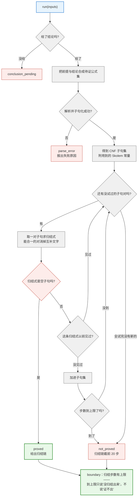
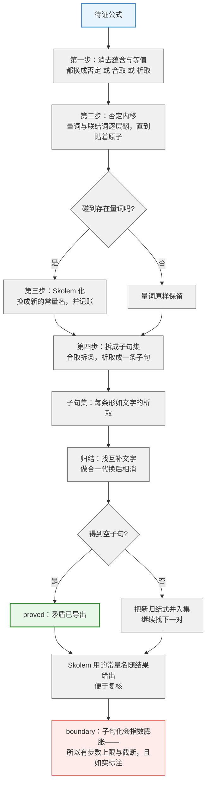

# 归结 resolution — 逻辑流程图

> 模块：`engine/classical/resolution.py` · 层：第 1 层经典逻辑（子句归结，带量词）
> 一句话：把公式**子句化成 CNF 子句集**（顺带把存在量词换掉），再对着子句对反复求归结式——
> **出现空子句就证明成立**，归结步数用完就如实报"没到结论"，并把每步归结式留痕。
> 图 1 → `run()` 主流程：子句化 → 归结 → 空子句
> 图 2 → 子句化四步与 Skolem 化的记账
> 判据与写法约定见 `docs/diagrams/README.md`。

## 一、run(inputs) 主流程：归结到空子句为止

## 二、子句化四步：消蕴含 → 否定内移 → Skolem 化 → 取 CNF

## 三、对着代码核过的口径与边界

- **输入**（`PORTS['in']`）：`premises`（前提列表）· `conclusion`（结论）·
  `facts`（额外事实）· `max_resolvents`（归结步数上限，默认 500）。
- **判词**：`proved` · `not_proved` · `parse_error` · `conclusion_pending`。
- **出口是"空子句"**：归结链里一旦出现空子句（链上记作 `□`），就是 `proved`——
  判据是**矛盾导出来了**，不是"看起来像"。
- **Skolem 化会记账**：存在量词换成新常量（形如 `c_1`、`c_2`），用到的名字在
  `skolem_used` 里列出；**常量名是新鲜生成的**，不与会话里已有名字撞车。
- **合一**：归结前先对两边的文字做合一（含出现检查，避免无限替换），
  合一代换作用到整条归结式上。
- **两条如实标注的截断**：归结步数到 `max_resolvents` 或子句对试尽仍无新子句 →
  `not_proved`，且**归结链只截前 20 步**（免得结果里塞进整条长链）。
- **诚实边界**（`boundary` 字段随每个返回点带回）：子句化与归结都可能指数膨胀，
  所以**上限与截断都写在返回里**；`not_proved` 只意味着"按这个上限没归结出来"，
  **不等于"结论不成立"**；本件只判可证性，不做取舍决策。
