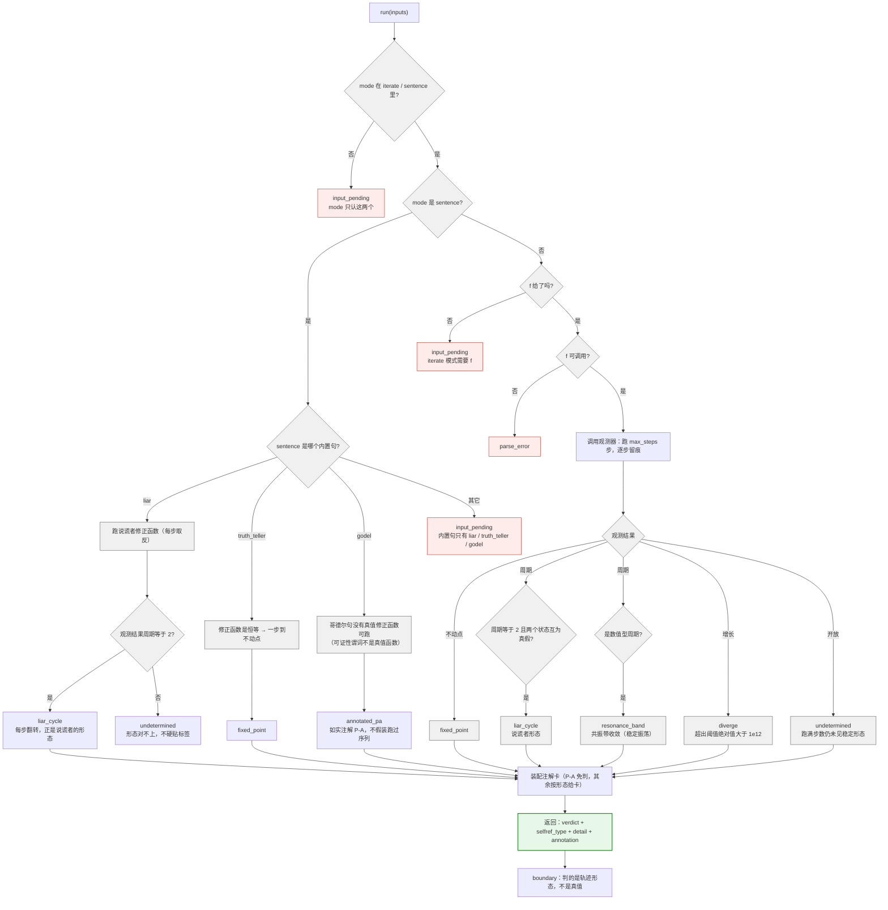
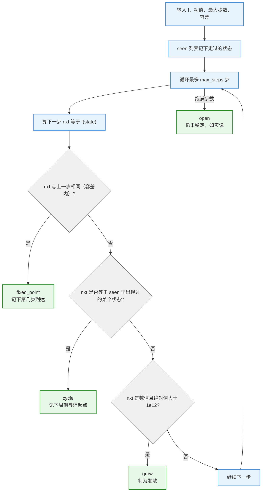

# 自指检测 selfref_fixpoint — 逻辑流程图

> 模块：`engine/mechanisms/selfref_fixpoint.py` · 层：第 2 层机制（钻墙主力）
> 一句话：把递归修正跑起来看它**落在哪一格**——不动点 / 共振带（稳定振荡）/ 发散 / 说不清；
> 内置三种经典自指句（说谎者 · 真话者 · 哥德尔句），也给自定义修正函数的口子。
> 图 1 → 两种 mode 的主流程（内置句 / 自定义函数）
> 图 2 → 观测器把轨迹判成哪一类
> 判据与写法约定见 `docs/diagrams/README.md`。

## 一、run(inputs) 主流程

## 二、观测器 `_observe`：把一条轨迹判成哪一格

## 三、对着代码核过的口径与边界

- **输入**（`PORTS['in']`）：`mode`（`iterate` / `sentence`）· `f`（修正函数）· `state0` ·
  `sentence`（`liar` / `truth_teller` / `godel`）· `max_steps` · `tol`。
- **判词**：`fixed_point` · `resonance_band` · `liar_cycle` · `diverge` · `undetermined` ·
  `annotated_pa` · `input_pending` · `parse_error`。
- **观测器的内部形态词**（不直接对外）：`fixed_point` · `cycle` · `grow` · `open`。
- **留痕**：`detail` 带到达步数、周期与环起点、以及整条 `trace`——"只迭代一轮就停"这类毛病一眼看得出。
- **诚实边界**：判的是**轨迹形态**（落在哪一格），**不是真值**；哥德尔句**没有**真值修正函数可跑，
  所以只给 P-A 注解、**不假装跑过序列**；跑满步数仍未稳定时如实报 `undetermined`，不硬贴标签。
