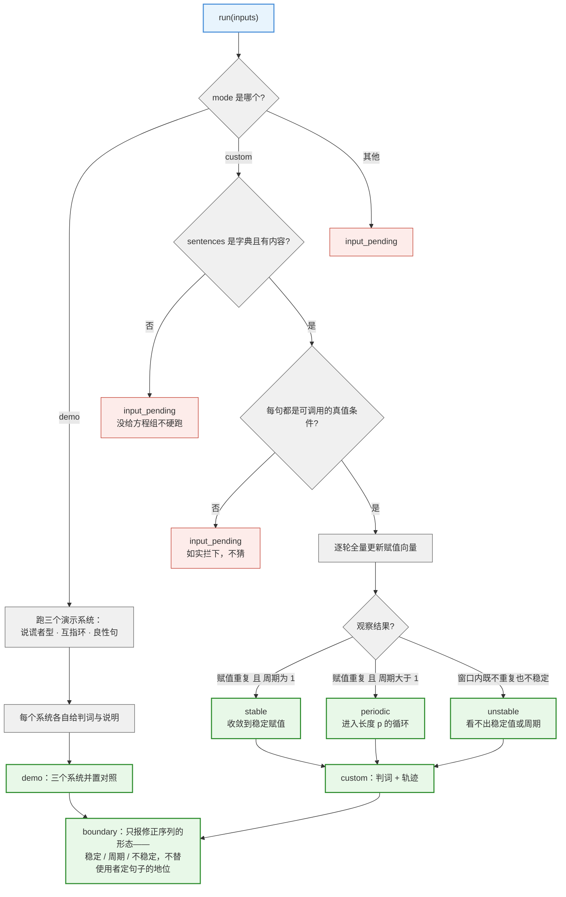
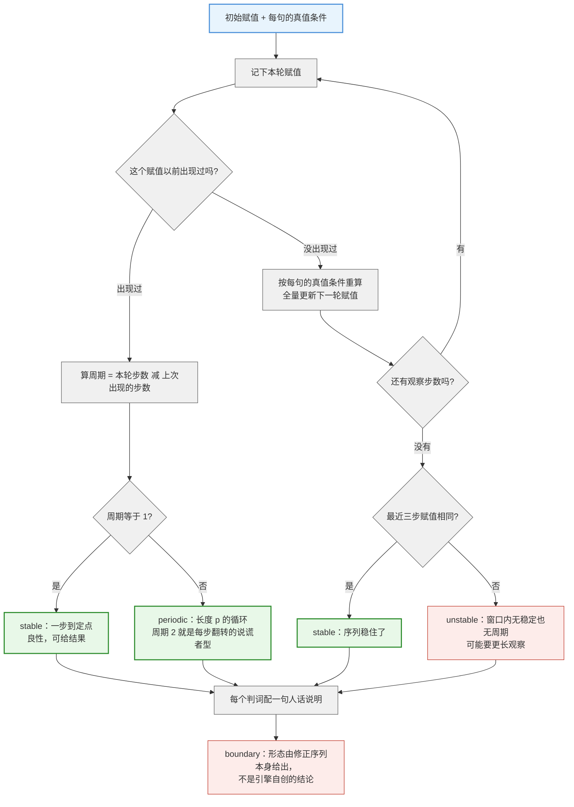

# 真值修正 truth_revision — 逻辑流程图

> 模块：`engine/cold/truth_revision.py` · 层：第 3 层冷门逻辑（自指与修正序列）
> 一句话：给一组**互相引用的句子**，按"每句重新算真值"迭代下去——
> 看它是**收敛到定点**、**进入周期振荡**，还是**窗口内既不收敛也不周期**。
> 图 1 → `run()` 两个模式：内置三个演示系统 / 自定方程组
> 图 2 → 迭代观察怎么分出三态（定点 / 周期 / 不稳定）
> 判据与写法约定见 `docs/diagrams/README.md`。

## 一、run(inputs) 主流程：两组演示 + 自定方程组

## 二、迭代观察：三态是怎么分出来的

## 三、对着代码核过的口径与边界

- **输入**（`PORTS['in']`）：`mode`（`demo` / `custom`）· `sentences`（每句一个可调用的真值条件）·
  `start`（初始赋值）· `max_steps`（观察步数上限，默认 50）。
- **判词**：`stable` · `periodic` · `unstable` · `demo` · `input_pending`。
- **一条要点：周期 1 与定点是同一件事**。赋值重复且周期为 1 → `stable`（一步到定点）；
  周期大于 1 才是真振荡。所以"到定点"有**两条到达路径**（逐步稳住 / 一步稳住），
  出口都记 `stable`，用 `fixed_value` 给出定在哪。
- **周期 2 就是说谎者型**：句子每步在真/假之间翻转——修正理论的口径是"**无稳定真值，
  落入振荡**"（这是学界共识的口径，不是本引擎自创的结论）；周期更大则报长度 p 的循环。
- **不稳定的判据是"窗口"**：走满观察步数后，若最近三步赋值相同仍算 `stable`；
  否则 `unstable`——**只说"这个窗口里看不出来"**，不说"它永远不稳定"。
- **全量更新**：每一轮所有句子一起重算（不是逐句就地改），所以轨迹可复现、可逐步核对。
- **诚实边界**（`boundary` 字段随每个返回点带回）：本件只报**修正序列的形态**
  （收敛 / 周期 / 窗口内不稳定），并给出轨迹让人复核；**不判定句子的真值地位**，
  也不替使用者决定"该采用哪一套真值条件"。
