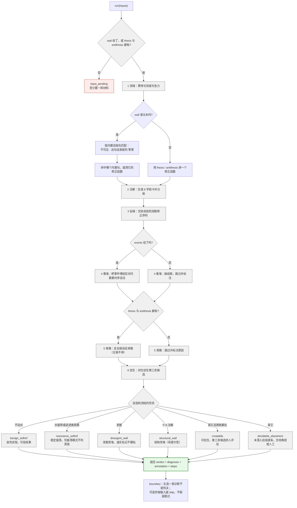
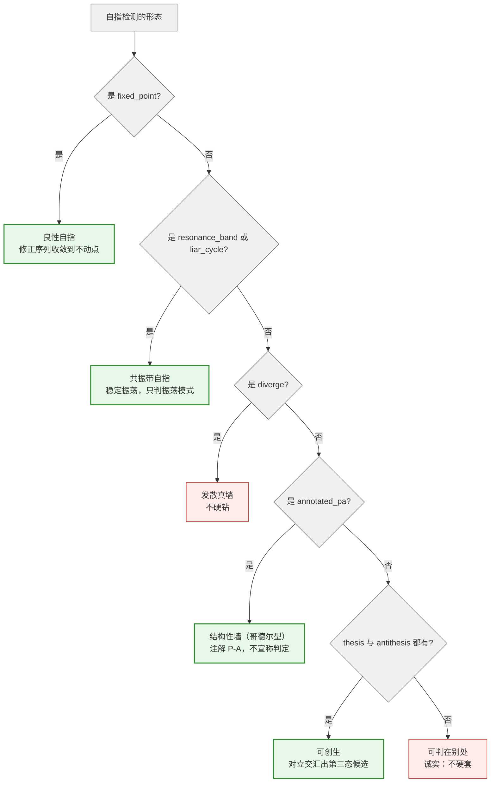

# 撞墙管线 wall_pipeline — 逻辑流程图

> 模块：`engine/mechanisms/wall_pipeline.py` · 层：第 2 层机制（撞墙管线 A）
> 一句话：经典层撞到不可判定时上卷到这里——**测墙 → 注解 → 钻墙 → 看墙 → 旁路 → 创生**，
> 最后给**五选一诊断**（可判在别处 / 良性自指 / 共振带自指 / 发散真墙 / 可创生）。
> 图 1 → 六步主流程与五选一
> 图 2 → 五选一是怎么从"钻"的结果映射出来的
> 判据与写法约定见 `docs/diagrams/README.md`。

## 一、run(inputs) 主流程：六步走完才给诊断

## 二、五选一的映射规则（钻的结果 → 一只出口）

## 三、对着代码核过的口径与边界

- **输入**（`PORTS['in']`）：`wall`（墙的文本或描述）· `thesis` / `antithesis`（对立两侧）·
  `events`（事件线索，喂区间代数用）。
- **判词**：`benign_selfref` · `resonance_selfref` · `divergent_wall` · `structural_wall` ·
  `creatable` · `decidable_elsewhere` · `input_pending`。
- **六步都留在 `steps` 里**：每步记 `step` / `status`（跑了 / skip）与 `detail`，
  可选步缺输入时 `status` 为 skip 并**写明原因**（`skip——wall 未给` 这类）。
- **`diagnosis` 汇总**：`label`（人话结论）· `mu`（测墙的测度）· `grade`（注解分级）·
  `drill`（钻的结果）· `tension`（看墙的张力）。
- **诚实边界**（`boundary`）：五选一是**诊断不是判决**（只诊断不决策）；
  **共振带自指不等于判真值**；发散真墙 / 结构性墙是**合法输出**（不宣称绕停机 / 哥德尔）；
  可选步缺输入就 skip——诚实标注，不假装跑过。
